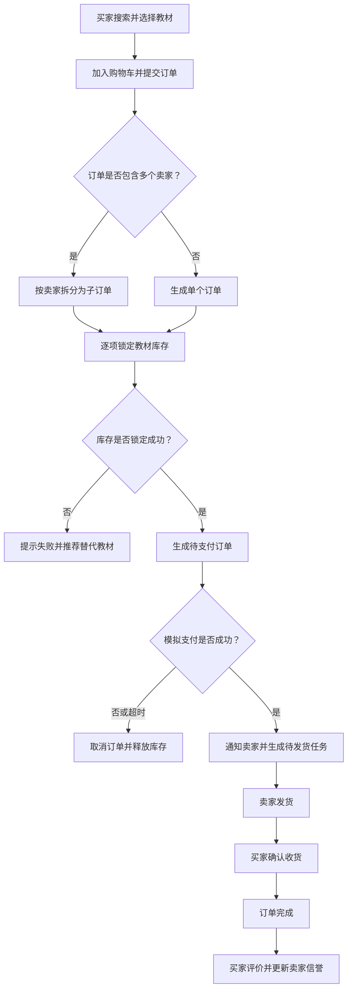

# 校园二手教材交易平台

## 项目简介

本项目建设一个校园二手教材交易平台，为高校学生提供教材发布、检索、购买、订单跟踪和评价等能力，帮助学生低成本获取教材，并提高闲置教材的利用率。

## 业务背景

每学期都会产生大量闲置教材，同时又有大量学生需要购买教材。目前交易信息往往分散在班级群、聊天群中，存在搜索困难、信息更新不及时、交易记录不完整、订单和商品状态难以追踪等问题。本项目聚焦校园教材场景，建立统一的交易平台，规范从发布、下单、支付、发货到确认收货和评价的完整流程。

## 项目目标与适用场景

本项目旨在建设一个校园二手教材交易平台，帮助学生发布、查找和购买闲置教材，形成从商品发布、下单、支付、发货到确认收货和评价的完整交易闭环。

适用场景包括：

- 学生在每学期结束后发布不再使用的教材。
- 学生在开学前搜索并购买价格合适的二手教材。
- 卖家管理商品、库存、订单和发货状态。
- 管理员审核商品、管理用户并处理异常交易。
- 后续用于验证服务拆分、消息通信、事务补偿、监控和部署等微服务能力。

## 目标用户与需求

| 用户角色 | 主要需求 |
|---|---|
| 学生买家 | 搜索教材，查看价格和书况，加入购物车，下单，模拟支付，跟踪订单，确认收货并评价 |
| 学生卖家 | 发布和编辑教材，管理库存，查看订单，处理发货，查看评价和交易记录 |
| 平台管理员 | 审核商品，管理用户，查询订单，处理违规内容和异常交易 |
| 游客 | 浏览教材列表和详情，注册或登录后参与交易 |

## 功能模块划分

| 功能模块 | 具体功能 |
|---|---|
| 用户与认证 | 注册、登录、退出、个人资料、角色权限、卖家认证、管理员权限 |
| 教材目录与检索 | 教材分类、关键词搜索、ISBN/书名/作者查询、书况展示、分页排序 |
| 商品与库存 | 发布教材、编辑价格和书况、上下架、库存锁定、库存释放、防止重复出售 |
| 购物车与订单 | 加入购物车、确认订单、按卖家拆单、订单状态流转、取消订单、超时关闭 |
| 支付 | 创建模拟支付单、支付回调、支付结果查询、幂等处理、超时取消 |
| 物流与履约 | 卖家发货、记录物流状态、买家确认收货、订单完成 |
| 评价与信誉 | 评分、文字评价、评价查询、卖家信誉更新 |
| 通知 | 支付成功、订单取消、卖家发货、订单完成等事件通知 |
| 后台管理 | 商品审核、用户管理、订单查询、违规下架、基础统计 |

## 核心业务流程

以“买家购买多个卖家的二手教材”为例：




## 当前项目范围

第一阶段聚焦核心交易闭环：

```text
发布教材 → 搜索浏览 → 下单 → 拆分订单 → 锁定库存
→ 模拟支付 → 卖家发货 → 确认收货 → 评价
```

当前阶段暂不实现：

- 真实第三方支付和真实物流接口。
- 实时聊天、议价和语音功能。
- 智能推荐、优惠券和秒杀活动。
- 复杂退款、售后仲裁和纠纷处理。
- 多校区、多仓库和跨平台同步。
- 完整的高并发和商业级容量规划。

支付和物流采用模拟方式，目的是突出微服务架构、服务协作和分布式问题，而不是实现完整商业电商平台。

## 工程运行说明

### 环境要求

- JDK 25
- Maven 3.9 及以上；也可以直接使用项目自带的 Maven Wrapper（`mvnw`、`mvnw.cmd`）

### 运行步骤

Git Bash / macOS / Linux：

```bash
cd monolith
./mvnw test
./mvnw spring-boot:run
```

Windows PowerShell：

```powershell
cd monolith
.\mvnw.cmd test
.\mvnw.cmd spring-boot:run
```

应用默认端口为 `8080`。

### 访问地址

- 问候接口：`GET http://localhost:8080/api/hello`
- 健康检查：`GET http://localhost:8080/actuator/health`

### 当前尚未实现的业务能力

当前阶段只完成可运行的单体工程骨架，尚未实现以下业务能力：

- 用户注册、登录与权限控制
- 教材发布、搜索和详情接口
- 商品库存锁定与释放
- 购物车、订单和多卖家拆单
- 模拟支付、支付回调和超时取消
- 发货、物流状态和确认收货
- 评价与信誉
- 通知和后台管理
- 数据库、Repository、Service 和完整 REST API
- 真实支付、真实物流、消息队列和分布式事务

## 后续演进方向

| 演进方向 | 后续内容 |
|---|---|
| 认证授权 | JWT/OAuth2、RBAC、角色权限、服务间认证、卖家实名认证 |
| 服务拆分 | 网关、用户、教材目录、商品库存、订单、支付、物流、评价、通知 |
| 数据持久化 | 每个服务独立数据库或独立 Schema，通过接口和事件访问数据 |
| 消息通信 | 订单创建、支付成功、支付超时、发货、确认收货、评价等事件 |
| 事务处理 | Saga、Outbox、消息补偿、幂等消费、库存释放和超时取消 |
| 监控运维 | 健康检查、日志聚合、指标监控、链路追踪和告警 |
| 部署发布 | Docker Compose、配置管理、CI/CD，后续可扩展到 Kubernetes |

## 单体业务实现

完成了教材发布、教材查询、订单创建和订单查询流程。

### 新增接口

| 方法 | 路径 | 说明 |
|---|---|---|
| POST | `/api/textbooks` | 创建教材 |
| GET | `/api/textbooks?keyword=Java` | 查询教材 |
| GET | `/api/textbooks/{id}` | 查询教材详情 |
| POST | `/api/orders` | 创建订单 |
| GET | `/api/orders/{id}` | 查询订单详情 |

### 启动应用

Windows PowerShell：

```powershell
cd D:\microservices\microservices-practice-2412190107\monolith
.\mvnw.cmd spring-boot:run
```

### MySQL 安装和建库
安装本地 MySQL 8.x 后执行：
```text
CREATE DATABASE campus_textbook
    DEFAULT CHARACTER SET utf8mb4
    COLLATE utf8mb4_unicode_ci;
```

然后修改：
```text
monolith/src/main/resources/application.yml
```
中的数据库用户名和密码：
```text
spring:
  datasource:
    url: jdbc:mysql://localhost:3306/campus_textbook?useUnicode=true&characterEncoding=utf8&serverTimezone=Asia/Shanghai
    username: root
    password: ${MYSQL_PASSWORD}
```
应用启动后，JPA 会自动创建 textbooks 和 trade_orders 表。

### curl 示例

创建教材：

```text
curl -X POST http://localhost:8080/api/textbooks \
  -H "Content-Type: application/json" \
  -d '{
    "title": "Java 程序设计",
    "isbn": "9787300000010",
    "author": "张三",
    "publisher": "高等教育出版社",
    "conditionDescription": "九成新",
    "price": 29.90,
    "stock": 3,
    "sellerId": 1001
  }'
```

查询教材：

```text
curl "http://localhost:8080/api/textbooks?keyword=Java"
```

查询全部在售教材：

```text
curl "http://localhost:8080/api/textbooks"
```

创建订单时，将 textbookId 替换为创建教材接口返回的实际 ID：

```text
curl -X POST http://localhost:8080/api/orders \
  -H "Content-Type: application/json" \
  -d '{
    "buyerId": 2001,
    "textbookId": 1,
    "quantity": 1
  }'
```

查询订单：

```text
curl "http://localhost:8080/api/orders/1"
```

测试命令
```text
cd D:\microservices\microservices-practice-2412190107\monolith
.\mvnw.cmd test
```
测试使用 H2 内存数据库，不依赖本地 MySQL。每次测试执行前会自动清理并准备测试数据，因此可以重复执行。

## Docker 容器化运行

### 环境要求

安装并启动 Docker Desktop，使用 Linux 容器模式。

检查 Docker 和 Compose：

```powershell
docker version
docker compose version
```

构建在容器内完成，不需要本机 Maven 或 Java。

以下命令均从仓库根目录开始执行：

```powershell
cd D:\microservices\microservices-practice-2412190107
```

### 复制配置模板

首次运行时，从模板创建本地配置；已有 `.env` 时不覆盖：

```powershell
if (!(Test-Path .env)) {
    Copy-Item .env.example .env
}
```

打开配置文件：

```powershell
notepad .env
```

修改并保存以下配置：

```dotenv
APP_PORT=8080
MYSQL_PORT=3307
DB_NAME=campus_textbook
DB_USER=campus_app
DB_PASSWORD=请替换为自己的应用数据库密码
DB_ROOT_PASSWORD=请替换为自己的数据库管理员密码
```

### 构建镜像

在仓库根目录执行：

```powershell
docker build -t campus-textbook:week05 ./monolith
```

检查构建结果：

```powershell
docker image ls campus-textbook
```

### 一键启动

先检查编排配置：

```powershell
docker compose config --quiet
```

构建并后台启动：

```powershell
docker compose up -d --build
```

如果本机已有 Spring Boot 占用 8080，请先停止它，或者修改 `.env` 中的 `APP_PORT`。

### 查看状态和日志

查看容器状态：

```powershell
docker compose ps
```

MySQL 应显示 `healthy`，应用应处于运行状态。

查看应用日志：

```powershell
docker compose logs --tail=100 app
```

查看数据库日志：

```powershell
docker compose logs --tail=100 mysql
```

持续查看应用日志：

```powershell
docker compose logs -f app
```

按 `Ctrl+C` 仅退出日志查看，不会停止后台容器。

### 验证健康接口

以下示例按 `APP_PORT=8080` 编写；修改端口后，请同步调整访问地址。

```powershell
$baseUrl = "http://localhost:8080"
curl.exe -i "$baseUrl/actuator/health"
```

预期返回 HTTP 200，响应包含：

```json
{
  "status": "UP"
}
```

如果应用尚未启动完成，稍后重试。

### 业务 API 示例一：创建教材

下面命令使用随机测试 ISBN，避免重复执行时与同一卖家的已有 ISBN 冲突。该 ISBN 仅用于接口测试。

```powershell
$baseUrl = "http://localhost:8080"

$body = @{
    "title": "计算机组成原理",
    "isbn": "9787300000502",
    "author": "唐朔飞",
    "publisher": "高等教育出版社",
    "conditionDescription": "九成新",
    "price": 25.50,
    "stock": 3,
    "sellerId": 1001
} | ConvertTo-Json

$response = Invoke-WebRequest `
    -Uri "$baseUrl/api/textbooks" `
    -Method Post `
    -ContentType "application/json; charset=utf-8" `
    -Body ([System.Text.Encoding]::UTF8.GetBytes($body)) `
    -UseBasicParsing

$response.StatusCode
$response.Content

$created = $response.Content | ConvertFrom-Json
$textbookId = $created.id

Write-Output "创建的教材ID：$textbookId"
```

预期状态码为 `201`，响应包含教材 ID、书名、ISBN、价格和库存。

### 业务 API 示例二：查询教材详情

在执行创建示例后的同一个 PowerShell 窗口中运行：

```powershell
curl.exe -i "$baseUrl/api/textbooks/$textbookId"
```

预期返回 HTTP 200，ID、书名、ISBN、价格和库存与创建结果一致。

如果新开了终端，请先设置地址和真实教材 ID，例如：

```powershell
$baseUrl = "http://localhost:8080"
$textbookId = Read-Host "请输入之前创建的教材ID"

curl.exe -i "$baseUrl/api/textbooks/$textbookId"
```

### 业务 API 示例三：查询在售教材列表

```powershell
curl.exe -i "http://localhost:8080/api/textbooks"
```

预期返回 HTTP 200 和 JSON 数组。没有教材时返回空数组。

### 停止与再次启动

仅停止容器，保留容器、网络和数据卷：

```powershell
docker compose stop
```

再次启动已停止的容器：

```powershell
docker compose start
```

停止并删除容器及项目网络，但保留命名数据卷：

```powershell
docker compose down
```

重新创建并启动容器：

```powershell
docker compose up -d
```

### 数据持久化验证

在创建教材后，保留实际教材 ID，在同一个终端中执行：

```powershell
docker compose down
docker volume ls
docker compose up -d
docker compose ps
```

等待应用健康接口返回 HTTP 200：

```powershell
curl.exe -i "$baseUrl/actuator/health"
```

然后查询原来的教材，不要重新创建：

```powershell
curl.exe -i "$baseUrl/api/textbooks/$textbookId"
```

确认记录仍存在，且 ID、书名、ISBN、价格和库存与容器重建前一致。

MySQL 数据通过命名数据卷 `mysql_data` 挂载到容器的 `/var/lib/mysql`，因此数据独立于容器保存。

**持久化验证不要执行 `docker compose down -v`，该命令会删除数据卷及其中的数据库数据。**

## 课程信息

- 课程：微服务开发与实践
- 姓名：字远
- 学号：2412190107
- 仓库用途：本仓库用于完成《微服务开发与实践》课程项目，设计并实现一个校园二手教材交易平台。系统面向买家、卖家和管理员，支持二手教材发布、检索、下单、多卖家订单拆分、库存锁定与释放、模拟支付、物流跟踪、评价和通知等核心业务流程。
