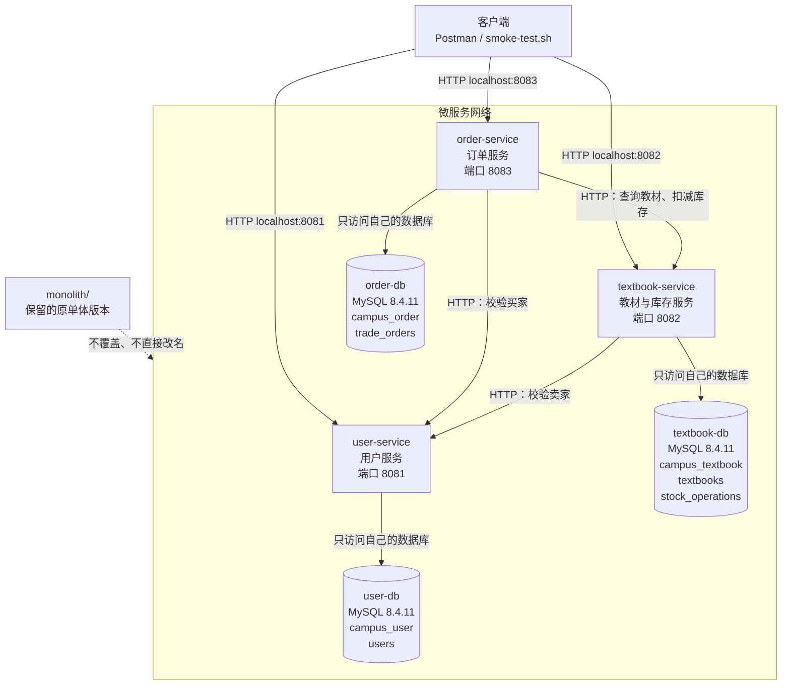

# 第六周：微服务拆分设计

## 一、服务拆分设计

### 1. 设计目标

本周在保留 `monolith/` 单体工程的基础上，设计后续微服务拆分方案，为下一步创建独立 Spring Boot 服务做准备。

本项目按照业务职责拆分为：

- `user-service`：用户服务；
- `textbook-service`：教材与库存服务；
- `order-service`：订单服务。

单体工程不会被重命名或覆盖，后续微服务统一放在仓库根目录的 `services/` 下。

### 2. 单体模块到微服务的映射

| 单体模块 | 微服务 | 主要职责 |
|---|---|---|
| `buyerId`、`sellerId` 用户标识 | `user-service` | 用户创建、查询和启用状态管理 |
| `Textbook`、`TextbookRepository` | `textbook-service` | 教材发布、查询、价格、上架状态和库存管理 |
| `TradeOrder`、`TradeOrderRepository` | `order-service` | 订单创建、订单状态、交易快照和订单查询 |
| `TradeService` | 拆分到三个服务 | 按业务边界分别保留用户、教材库存和订单逻辑 |

### 3. 服务职责和数据归属

| 服务 | 端口 | 独立数据库 | 数据表 |
|---|---:|---|---|
| `user-service` | 8081 | `campus_user` | `users` |
| `textbook-service` | 8082 | `campus_textbook` | `textbooks`、`stock_operations` |
| `order-service` | 8083 | `campus_order` | `trade_orders` |

每个服务只读写自己的数据库和 Repository。

跨服务关联只保存对方的 ID：

- `textbooks.seller_id` 保存用户服务中的用户 ID；
- `trade_orders.buyer_id` 保存用户服务中的用户 ID；
- `trade_orders.seller_id` 保存用户服务中的用户 ID；
- `trade_orders.textbook_id` 保存教材服务中的教材 ID。

这些字段不建立跨数据库外键，也不进行跨库 JOIN。

### 4. 服务调用关系

服务之间通过 HTTP API 协作：

```text
textbook-service → user-service
```

教材服务发布教材时，调用用户服务检查卖家是否存在并处于启用状态。

```text
order-service → user-service
```

订单服务创建订单时，调用用户服务检查买家是否存在并处于启用状态。

```text
order-service → textbook-service
```

订单服务创建订单时，通过教材服务查询教材并请求库存扣减。

订单服务不直接访问教材服务的 Repository，教材服务也不直接访问用户服务的 Repository。


### 5. 核心业务流程
```text
买家提交订单
  ↓
订单服务校验买家
  ↓
订单服务调用教材服务查询教材
  ↓
教材服务检查上架状态和库存
  ↓
教材服务扣减库存并返回成交快照
  ↓
订单服务保存订单
  ↓
客户端查询订单
```

库存检查和扣减必须在教材服务的本地事务中完成。

当库存不足、教材下架或用户不存在时，业务请求应被拒绝。

### 6. Mermaid 架构图


### 7. 实现思路
服务拆分遵循业务内聚和数据独立原则。用户服务只负责用户数据，教材服务同时负责教材和库存，以保证上架状态、价格和库存检查可以在一个本地事务中完成，订单服务负责订单状态和交易快照。

订单服务通过 HTTP 调用其他服务，不直接访问其他服务的数据库。跨服务失败时，订单服务需要记录处理中状态，并使用订单编号保证库存扣减请求的幂等性。

### 8. 文档检查命令
在仓库根目录执行：
```text
cd D:\microservices\microservices-practice-2412190107
Test-Path .\docs\microservices-design.md
rg -n "user-service|textbook-service|order-service|mermaid|独立数据库|HTTP" .\docs\microservices-design.md
git diff --check
```

### 9. 检查结果
```text
Test-Path 返回 True；
rg 能检索到三个服务名称、Mermaid 架构图、独立数据库和 HTTP 调用说明；
git diff --check 无输出，说明文档格式没有空白错误。
```

本阶段只完成服务边界和调用关系设计，尚未创建 services/ 下的独立 Spring Boot 工程，也未改变原有 monolith/ 工程。

## 二. 代码拆分

### 1 实现思路

保留原有 `monolith/` 单体工程，在仓库根目录的 `services/` 下建立三个独立的 Spring Boot 工程：

```text
services/
├── user-service/
│   ├── pom.xml
│   └── src/
├── textbook-service/
│   ├── pom.xml
│   └── src/
└── order-service/
    ├── pom.xml
    └── src/
```

每个服务均包含独立的 `pom.xml`、配置文件、Controller、Service、
Repository 和测试代码，Java 基础包名继续使用 `com.zjgsu.zy`，
各层代码位于基础包的子包中。

服务职责和本阶段本地运行配置如下：

| 服务 | 本机端口 | 数据库 | 主要职责 |
| --- | --- | --- | --- |
| user-service | 8081 | campus_user | 创建用户、查询用户 |
| textbook-service | 8082 | campus_textbook_ms | 发布教材、查询教材、维护库存和库存操作记录 |
| order-service | 8083 | campus_order | 校验下单条件、创建订单、查询订单 |

本阶段使用同一 MySQL 实例中的不同数据库，并为各服务配置独立数据库账号。
教材服务使用 `campus_textbook_ms`，避免与原单体数据库混用。

每个服务只通过自己的 Repository 访问自己的数据库。
跨服务关联只保存用户 ID、教材 ID 等标识，不建立跨库外键，
也不直接调用其他服务的 Repository。

### 2. 跨服务业务流程

选择“买家购买二手教材”作为跨服务业务流程：

1. 在用户服务中创建卖家和买家。
2. 卖家通过教材服务发布教材。
3. 教材服务通过 HTTP 调用用户服务，确认卖家存在后保存教材。
4. 买家通过订单服务提交下单请求。
5. 订单服务通过 HTTP 调用用户服务，确认买家存在。
6. 订单服务通过 HTTP 调用教材服务，查询教材并请求扣减库存。
7. 所有依赖校验和库存扣减成功后，订单服务保存本地订单。

跨服务调用使用 `RestTemplate`。
服务地址在 `application.yml` 中配置，并支持环境变量覆盖：

| 环境变量 | 用途 |
| --- | --- |
| USER_SERVICE_URL | 用户服务地址，本地运行使用 http://localhost:8081 |
| TEXTBOOK_SERVICE_URL | 教材服务地址，本地运行使用 http://localhost:8082 |
| HTTP_CONNECT_TIMEOUT_MS | HTTP 连接超时，默认 2000 毫秒 |
| HTTP_READ_TIMEOUT_MS | HTTP 读取超时，默认 3000 毫秒 |

数据库连接通过 `DB_URL`、`DB_USERNAME`、`DB_PASSWORD` 配置。
本地启动时通过 `SERVER_PORT` 分别设置三个服务的端口。

依赖资源不存在时返回明确错误；依赖服务连接失败或超时时返回服务不可用错误，
不能跳过校验直接创建本地教材或订单记录。

订单创建使用 `requestId` 标识同一次请求，
教材服务保存库存操作记录，避免同一请求重试时重复扣减库存。

本实现不提供跨服务数据库事务。
如果库存扣减成功，但后续订单保存失败或响应丢失，需要使用原 `requestId`
重试；尚未实现自动补偿和后台对账。

### 3. 运行命令

以下命令在 Windows PowerShell 中执行。

#### 3.1 进入仓库根目录

```powershell
Set-Location D:\microservices\microservices-practice-2412190107
```

#### 3.2 分别运行三个服务的测试

```powershell
mvn -f services/user-service/pom.xml clean test
mvn -f services/textbook-service/pom.xml clean test
mvn -f services/order-service/pom.xml clean test
```

测试使用测试配置和 H2 数据库，不依赖本地 MySQL 中的业务数据。

如果本机没有安装 Maven，可以使用原单体工程中的 Maven Wrapper：

```powershell
.\monolith\mvnw.cmd -f services/user-service/pom.xml clean test
.\monolith\mvnw.cmd -f services/textbook-service/pom.xml clean test
.\monolith\mvnw.cmd -f services/order-service/pom.xml clean test
```

测试成功时，应看到 `BUILD SUCCESS`，并检查测试汇总中的
Failures 和 Errors 均为 0。

#### 3.3 启动三个服务

先创建数据库和对应账号，再打开三个 PowerShell 终端。
每个终端均进入仓库根目录，设置该服务对应的数据库连接和启动端口。

以下密码占位符必须替换为创建数据库账号时设置的真实密码。
环境变量仅在当前终端会话中生效，不把真实密码提交到 GitHub。

终端一：启动用户服务。

```powershell
Set-Location D:\microservices\microservices-practice-2412190107

$env:SERVER_PORT = "8081"
$env:DB_URL = "jdbc:mysql://localhost:3306/campus_user?useSSL=false&allowPublicKeyRetrieval=true&serverTimezone=Asia/Shanghai"
$env:DB_USERNAME = "user_app"
$env:DB_PASSWORD = "替换为用户服务数据库密码"

mvn -f services/user-service/pom.xml spring-boot:run
```

终端二：启动教材服务。

```powershell
Set-Location D:\microservices\microservices-practice-2412190107

$env:SERVER_PORT = "8082"
$env:DB_URL = "jdbc:mysql://localhost:3306/campus_textbook_ms?useSSL=false&allowPublicKeyRetrieval=true&serverTimezone=Asia/Shanghai"
$env:DB_USERNAME = "textbook_app"
$env:DB_PASSWORD = "替换为教材服务数据库密码"
$env:USER_SERVICE_URL = "http://localhost:8081"

mvn -f services/textbook-service/pom.xml spring-boot:run
```

终端三：启动订单服务。

```powershell
Set-Location D:\microservices\microservices-practice-2412190107

$env:SERVER_PORT = "8083"
$env:DB_URL = "jdbc:mysql://localhost:3306/campus_order?useSSL=false&allowPublicKeyRetrieval=true&serverTimezone=Asia/Shanghai"
$env:DB_USERNAME = "order_app"
$env:DB_PASSWORD = "替换为订单服务数据库密码"
$env:USER_SERVICE_URL = "http://localhost:8081"
$env:TEXTBOOK_SERVICE_URL = "http://localhost:8082"

mvn -f services/order-service/pom.xml spring-boot:run
```

如果使用 Maven Wrapper，将上述启动命令开头的 `mvn`
替换为 `.\monolith\mvnw.cmd`，其余参数保持不变。

`mvn test` 只运行测试，不会持续启动供 Postman 访问的服务。
Postman 验证期间需要保持三个服务的启动终端运行。

#### 3.4 检查健康接口

在第四个 PowerShell 终端中执行：

```powershell
curl.exe -i http://localhost:8081/actuator/health
curl.exe -i http://localhost:8082/actuator/health
curl.exe -i http://localhost:8083/actuator/health
```

也可以在 Postman 中使用 GET 方法访问以上地址。

预期三个接口均返回 HTTP 200，响应体中包含：

```json
{
  "status": "UP"
}
```

### 4. Postman 验证过程

使用 Postman 导入本次提供的请求集合。
按“健康检查 → 创建用户 → 发布教材 → 创建订单 → 查询 → 异常验证”
的顺序执行，使用接口实际返回的 ID 进行后续请求。

| 验证项目 | 请求或操作 | 预期结果 |
| --- | --- | --- |
| 服务健康检查 | 分别请求三个服务的 `/actuator/health` | 返回 200，状态为 UP |
| 创建卖家和买家 | POST `http://localhost:8081/api/users` | 返回 201，获得用户 ID |
| 发布教材 | POST `http://localhost:8082/api/textbooks` | 卖家校验成功，返回 201 |
| 创建订单 | POST `http://localhost:8083/api/orders` | 返回 201，订单状态为 PENDING_PAYMENT |
| 查询订单 | GET `http://localhost:8083/api/orders/{id}` | 返回 200，订单字段与创建结果一致 |
| 查询教材 | GET `http://localhost:8082/api/textbooks/{id}` | 返回 200，库存按购买数量减少 |
| 重复提交同一订单请求 | 保持 requestId 和请求内容不变，再次提交 | 返回原订单，库存不重复扣减 |
| 买家不存在 | 使用不存在的 buyerId 创建订单 | 返回 422，不新增订单和库存操作记录 |
| 教材不存在 | 使用不存在的 textbookId 创建订单 | 返回 422，不新增订单 |
| 库存不足 | 购买数量超过教材剩余库存 | 返回 409，库存不变，不新增订单 |
| 用户服务不可用 | 停止用户服务后尝试发布教材 | 返回 503，不新增教材 |
| 教材服务不可用 | 停止教材服务后提交新的订单请求 | 返回 503，不新增订单 |

验证服务不可用场景时，必须使用尚未成功处理过的新 `requestId`。
已经成功的请求再次提交时可能直接返回原订单，不能用于证明依赖服务不可用。

通过停止服务验证的是连接失败场景；
读取超时等场景由自动化测试中的受控 HTTP 服务进行验证。

### 5. 数据库核对方法

除检查 HTTP 响应外，还通过 MySQL Workbench 查询业务表，
对比操作前后的记录和库存，确认异常请求没有产生不应出现的本地写入。

```sql
SELECT * FROM campus_user.users ORDER BY id DESC;

SELECT * FROM campus_textbook_ms.textbooks ORDER BY id DESC;

SELECT COUNT(*) AS stock_operation_count
FROM campus_textbook_ms.stock_operations;

SELECT * FROM campus_order.trade_orders ORDER BY id DESC;
```

例如：教材初始库存为 3，成功购买 1 本后应变为 2；
使用相同 requestId 重试相同订单后仍为 2。
买家不存在、库存不足或依赖服务不可用时，对比请求前后的数据，
确认没有新增订单，相关库存没有错误变化。

### 6. 运行结果记录

以下内容在实际验证完成后填写，不将预期结果直接作为测试结论。

| 项目 | 实际结果 |
| --- | --- |
| user-service 自动化测试 | Tests run：【5】，Failures：【0】，Errors：【0】，构建结果：【BUILD SUCCESS】。 |
| textbook-service 自动化测试 | Tests run：【7】，Failures：【0】，Errors：【0】，构建结果：【BUILD SUCCESS】。 |
| order-service 自动化测试 | Tests run：【11】，Failures：【0】，Errors：【0】，构建结果：【BUILD SUCCESS】。 |
| 三个服务健康检查 | user-service 返回【200】、status 为【up】；textbook-service 返回【200】、status 为【up】；order-service 返回【200】、status 为【up】。 |
| 用户创建与教材发布 | 创建卖家返回【201】，sellerId 为【1】；创建买家返回【201】，buyerId 为【2】；发布教材返回【201】，textbookId 为【1】，初始库存为【3】。 |
| 订单创建与查询 | 创建订单返回【201】，orderId 为【1】，状态为【PENDING_PAYMENT】，购买数量为【1】；查询返回【200】，订单信息【一致】；教材库存由【3】变为【2】。 |
| 重复请求验证 | 使用相同 requestId 和请求内容再次提交，返回【201】；两次订单 ID【一致】，订单记录数不变，库存不变。 |
| 资源不存在与库存不足 | 买家不存在返回【422】，教材不存在返回【422】，库存不足返回【409】；数据库核对结果：【订单记录数、库存及库存操作记录无变化】。 |
| 依赖服务不可用 | 停止用户服务后发布教材，返回【503】，教材记录数不变；停止教材服务后使用新 requestId 下单，返回【503】，订单记录数不变。 |

### 7. 关键结论

代码拆分后，用户、教材和订单分别由独立服务管理。
跨服务数据通过 HTTP API 获取，数据访问边界保持独立。

订单服务在依赖校验和库存扣减成功后才保存本地订单，
依赖失败时返回明确错误，不跳过校验。
请求标识和库存操作记录用于支持同一业务请求的安全重试，
但不能代替完整的分布式事务、自动补偿和对账机制。

## 三. 本地编排

### 1. 实现思路

在仓库根目录使用 `compose.yaml` 统一编排三个微服务和三个独立的 MySQL 数据库：

| 容器 | 本机访问端口 | 作用 |
| --- | ---: | --- |
| user-service | 8081 | 用户服务 |
| textbook-service | 8082 | 教材和库存服务 |
| order-service | 8083 | 订单服务 |
| user-db | 不映射本机端口 | 用户服务数据库 |
| textbook-db | 不映射本机端口 | 教材服务数据库 |
| order-db | 不映射本机端口 | 订单服务数据库 |

每个微服务只使用自己的数据库、账号和数据卷：

- `user-service` 使用 `user-db` 和 `user_mysql_data`；
- `textbook-service` 使用 `textbook-db` 和 `textbook_mysql_data`；
- `order-service` 使用 `order-db` 和 `order_mysql_data`。

容器之间通过 Compose 服务名通信，不使用 `localhost`：

```text
textbook-service -> http://user-service:8080
order-service -> http://user-service:8080
order-service -> http://textbook-service:8080
```

数据库连接地址也使用 Compose 服务名：

```text
jdbc:mysql://user-db:3306/campus_user
jdbc:mysql://textbook-db:3306/campus_textbook
jdbc:mysql://order-db:3306/campus_order
```

应用端口映射到本机后，Postman 使用以下地址访问：

```text
http://localhost:8081
http://localhost:8082
http://localhost:8083
```

Compose 中为 MySQL 和三个应用配置了健康检查，并通过
`depends_on` 的 `condition: service_healthy` 控制启动顺序。
实际密码通过 `.env` 提供，`.env` 不提交到 GitHub，
只提交 `.env.example` 模板。

### 2. 配置检查和启动命令

在仓库根目录执行：

```powershell
Set-Location D:\microservices\microservices-practice-2412190107
```

检查 Compose 配置：

```powershell
docker compose config --quiet
```

构建镜像并启动全部服务：

```powershell
docker compose up -d --build
```

查看容器状态：

```powershell
docker compose ps
```

查看服务日志：

```powershell
docker compose logs --tail=100 user-service textbook-service order-service
```

停止并删除容器但保留数据卷：

```powershell
docker compose down
```

重新启动：

```powershell
docker compose up -d
```

本次验证没有使用：

```powershell
docker compose down -v
```

因为该命令会删除命名数据卷中的数据库数据。

### 3. 启动结果

配置检查结果：

```text
docker compose config --quiet
结果：【无错误输出】
```

镜像构建和启动结果：

```text
docker compose up -d --build
结果：【成功】
```

容器状态记录：

| 容器 | 实际状态 | 健康状态 |
| --- | --- | --- |
| user-db | 【running】 | 【healthy】 |
| textbook-db | 【running】 | 【healthy】 |
| order-db | 【running】 | 【healthy】 |
| user-service | 【running】 | 【healthy】 |
| textbook-service | 【running】 | 【healthy】 |
| order-service | 【running】 | 【healthy】 |

### 4. 健康接口验证

使用 Postman 或命令行请求：

```powershell
curl.exe --noproxy "*" -i http://localhost:8081/actuator/health
curl.exe --noproxy "*" -i http://localhost:8082/actuator/health
curl.exe --noproxy "*" -i http://localhost:8083/actuator/health
```

实际结果：

| 服务 | 请求地址 | 状态码 | 响应状态 | 验证结果 |
| --- | --- | ---: | --- | --- |
| user-service | `/actuator/health` | 【200】 | 【UP】 | 【通过】 |
| textbook-service | `/actuator/health` | 【200】 | 【UP】 | 【通过】 |
| order-service | `/actuator/health` | 【200】 | 【UP】 | 【通过】 |

三个服务正常时，应返回 HTTP `200`，响应内容包含：

```json
{"status":"UP"}
```

### 5. 业务 API 验证

通过 Postman 在容器启动后执行以下业务流程：

1. 创建卖家和买家；
2. 创建教材；
3. 创建订单；
4. 查询订单；
5. 查询教材并检查库存变化。

实际结果记录：

| 操作 | 请求地址 | 实际状态码 | 结果 |
| --- | --- | ---: | --- |
| 创建用户 | `POST http://localhost:8081/api/users` | 【201】 | sellerId = 【1】，buyerId = 【2】 |
| 创建教材 | `POST http://localhost:8082/api/textbooks` | 【201】 | textbookId = 【1】，初始库存 = 【3】 |
| 创建订单 | `POST http://localhost:8083/api/orders` | 【201】 | orderId = 【1】，状态 = 【200】 |
| 查询订单 | `GET http://localhost:8083/api/orders/{id}` | 【200】 | 返回订单信息【一致】 |
| 查询教材 | `GET http://localhost:8082/api/textbooks/{id}` | 【200】 | 库存由【3】变为【2】 |

订单服务能够通过 `user-service` 和 `textbook-service` 的 Compose 服务名完成跨服务调用，说明容器网络配置有效。

### 6. 数据卷持久化验证

先通过业务 API 创建一条订单，并记录订单 ID、教材 ID、
订单状态和教材库存。

然后执行：

```powershell
docker compose down
docker compose up -d
docker compose ps
```

等待应用健康后，重新查询原来的订单和教材：

```text
GET http://localhost:8083/api/orders/1
GET http://localhost:8082/api/textbooks/1
```

验证结果：

| 数据项 | 重建前 | 重建后 | 是否一致 |
| --- | --- | --- | --- |
| 订单 ID | 【1】 | 【1】 | 【是】 |
| 订单状态 | 【PENDING_PAYMENT】 | 【PENDING_PAYMENT】 | 【是】 |
| 买家 ID | 【2】 | 【2】 | 【是】 |
| 教材 ID | 【1】 | 【1】 | 【是】 |
| 购买数量 | 【1】 | 【1】 | 【是】 |
| 教材库存 | 【2】 | 【2】 | 【是】 |

命名数据卷分别挂载到各 MySQL 容器的
`/var/lib/mysql` 目录。`docker compose down` 只删除容器，
不会删除命名数据卷，因此重新创建容器后，原有订单、教材、
用户和库存数据仍然可以查询。

### 7. 完成结果和关键结论

本地编排完成了三个微服务、三个独立数据库、共享 Compose 网络、
健康检查、启动依赖和命名数据卷配置。验证时通过本机端口访问健康接口和业务 API，
容器内部通过服务名完成用户校验、教材查询、库存扣减和订单创建。
执行 `docker compose down` 后重新启动，原订单和教材数据仍可查询，
说明命名数据卷实现了数据库持久化。

## 四. 验证

### 1. 实现思路

验证分为健康检查、正常业务流程和失败场景三个部分。

1. 使用 `scripts/smoke-test.sh` 请求三个服务的健康接口，检查
   HTTP 状态码是否为200，以及响应中的status是否为UP。
2. 使用Postman执行创建卖家、创建买家、发布教材、创建订单、
   查询订单和查询教材的完整流程，验证服务间HTTP协作。
3. 选择“买家不存在”作为失败场景，检查订单服务是否明确拒绝请求。
4. 对比失败请求前后的订单数、教材库存和库存操作记录数，
   确认是否产生不应出现的业务写入。

### 2. 运行命令

打开Docker Desktop并等待引擎启动。
在Git Bash中进入仓库根目录：

```bash
cd /d/microservices/microservices-practice-2412190107
```

启动服务并查看状态：

```bash
docker compose up -d --build
docker compose ps
```

执行健康检查：

```bash
bash scripts/smoke-test.sh
echo $?
```

脚本至少调用以下接口：

```text
GET http://localhost:8081/actuator/health
GET http://localhost:8082/actuator/health
GET http://localhost:8083/actuator/health
```

全部检查通过时退出码为0；任意检查失败时退出码为1。

实际结果：

| 服务 | HTTP状态码 | 响应status | 结果 |
| --- | --- | --- | --- |
| user-service | 【200】 | 【up】 | 【通过】 |
| textbook-service | 【200】 | 【up】 | 【通过】 |
| order-service | 【200】 | 【up】 | 【通过】 |

脚本最终输出：【[CHECK] user-service: http://localhost:8081/actuator/health
[PASS] user-service HTTP 200, status=UP
[CHECK] textbook-service: http://localhost:8082/actuator/health
[PASS] textbook-service HTTP 200, status=UP
[CHECK] order-service: http://localhost:8083/actuator/health
[PASS] order-service HTTP 200, status=UP
[PASS] All three services are healthy】。

脚本退出码：【0】。

### 3. 正常跨服务业务验证

通过Postman依次执行以下请求：

| 操作 | 方法与地址 | 请求数据摘要 | 实际结果 |
| --- | --- | --- | --- |
| 创建卖家 | POST http://localhost:8081/api/users | 唯一studentNo、displayName | HTTP【201】，sellerId【4】 |
| 创建买家 | POST http://localhost:8081/api/users | 唯一studentNo、displayName | HTTP【201】，buyerId【5】 |
| 发布教材 | POST http://localhost:8082/api/textbooks | 实际sellerId，价格25.50，库存3及其他必填字段 | HTTP【201】，textbookId【3】 |
| 创建订单 | POST http://localhost:8083/api/orders | 新requestId、实际buyerId、textbookId、quantity=1 | HTTP【201】，orderId【2】，status【PENDING_PAYMENT】 |
| 查询订单 | GET http://localhost:8083/api/orders/2 | 本次实际订单ID | HTTP【200】，订单信息【一致】 |
| 查询教材 | GET http://localhost:8082/api/textbooks/3 | 本次实际教材ID | HTTP【200】，库存【2】 |

本次订单请求如下：

```json
{
  "requestId": "{{$guid}}",
  "buyerId": 5,
  "textbookId": 3,
  "quantity": 1
}
```

实际发送的requestId：【256f6a7d-ba14-4795-8a2e-bb7806a8a5d2】。

服务调用过程：

1. 教材服务调用用户服务，校验卖家后保存教材。
2. 订单服务调用用户服务，校验买家。
3. 订单服务调用教材服务，查询教材并请求扣减库存。
4. 远程操作成功后，订单服务保存本地订单。

数据变化记录：

| 数据项 | 下单前 | 下单后 |
| --- | --- | --- |
| 订单记录数 | 【1】 | 【2】 |
| 本次教材库存 | 【3】 | 【2】 |
| 库存操作记录数 | 【1】 | 【2】 |

验证结论：【订单新增1条、库存减少1、
库存操作记录新增1条，查询订单与创建响应一致】。

### 4. 依赖资源不存在验证

先确认测试买家不存在：

```text
GET http://localhost:8081/api/users/999999999
```

实际状态码：【404】。

记录订单数、教材库存和库存操作记录数后，提交新的订单请求：

```text
POST http://localhost:8083/api/orders
```

```json
{
  "requestId": "{{$guid}}",
  "buyerId": 999999999,
  "textbookId": 3,
  "quantity": 1
}
```

预期结果为HTTP 422，错误码为DEPENDENCY_NOT_FOUND。

实际结果：

- HTTP状态码：【422】。
- 响应code：【DEPENDENCY_NOT_FOUND】。
- 响应message：【user-service中的资源不存在，拒绝本次操作】。

请求前后数据对比：

| 数据项 | 失败请求前 | 失败请求后 | 是否不变 |
| --- | --- | --- | --- |
| 订单记录数 | 【2】 | 【2】 | 【是】 |
| 本次教材库存 | 【2】 | 【2】 | 【是】 |
| 库存操作记录数 | 【2】 | 【2】 | 【是】 |

验证结论：【没有新增订单和扣减库存】。

### 5. 数据库核对方法

在仓库根目录进入订单数据库：

```bash
docker compose exec order-db mysql -uorder_app -p campus_order
```

输入对应应用账号密码后执行：

```sql
SELECT COUNT(*) AS order_count FROM trade_orders;
EXIT;
```

进入教材数据库：

```bash
docker compose exec textbook-db mysql -utextbook_app -p campus_textbook
```

输入对应密码后执行：

```sql
SELECT id, title, stock FROM textbooks ORDER BY id DESC;
SELECT COUNT(*) AS operation_count FROM stock_operations;
EXIT;
```

### 6. “远端成功、本地失败”窗口

当前流程先由教材服务扣减库存，再由订单服务保存订单。
如果教材服务已经提交库存事务，而订单服务随后发生数据库写入失败
或进程退出，可能出现“库存已扣减，但订单未保存”的情况。

如果库存已扣减，但HTTP响应丢失或读取超时，
订单服务也可能无法确认远端是否成功。
因此，本地没有新增订单，不代表远端库存一定没有变化。

当前实现使用requestId派生固定的库存操作编号，
同一请求使用原requestId和相同参数重试，可以避免重复扣减。
但该机制不能代替跨服务原子事务，也不能保证故障后自动恢复一致。

本次仅验证顺序业务流程和基本失败处理。
未对上述窗口进行故障注入，不实现跨服务原子事务、
自动补偿或消息机制。
