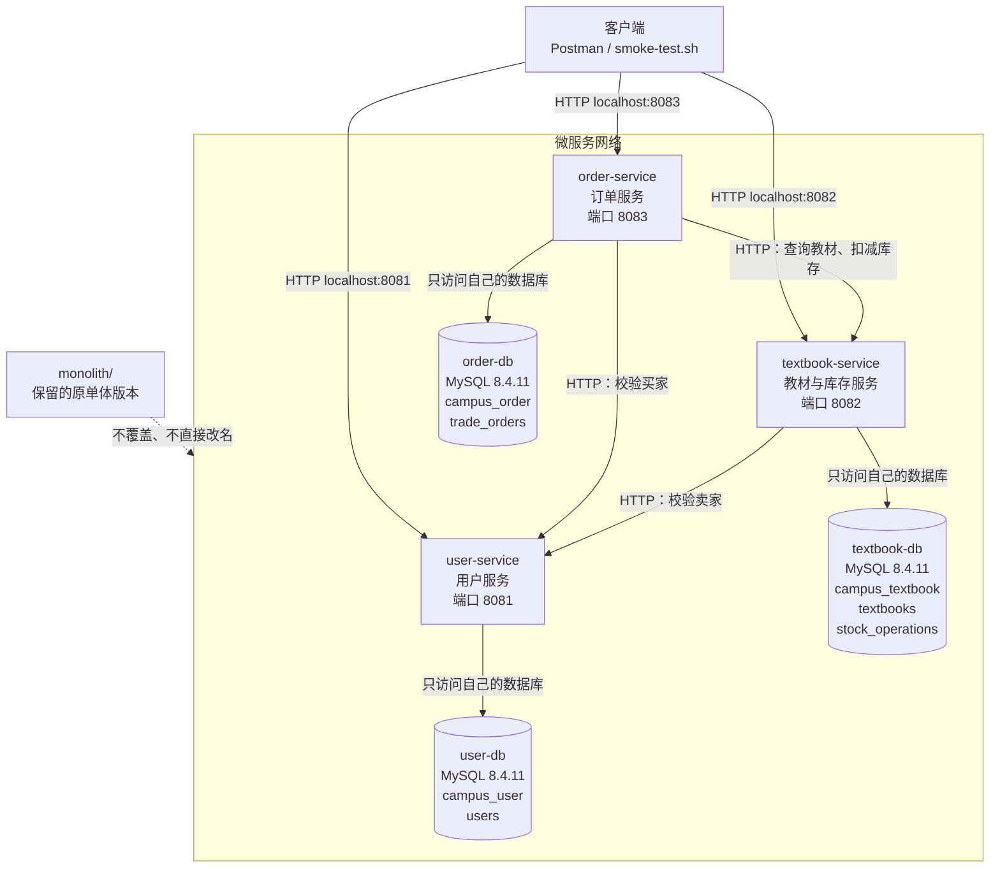

# 第六周：微服务拆分设计

## 一、服务拆分设计

### 1. 设计目标

本周在保留 `monolith/` 单体工程的基础上，设计后续微服务拆分方案，为下一步创建独立 Spring Boot 服务做准备。

本项目按照业务职责拆分为：

- `user-service`：用户服务；
- `textbook-service`：教材与库存服务；
- `order-service`：订单服务。

单体工程不会被重命名或覆盖，后续微服务统一放在仓库根目录的 `services/` 下。

### 2. 单体模块到微服务的映射

| 单体模块 | 微服务 | 主要职责 |
|---|---|---|
| `buyerId`、`sellerId` 用户标识 | `user-service` | 用户创建、查询和启用状态管理 |
| `Textbook`、`TextbookRepository` | `textbook-service` | 教材发布、查询、价格、上架状态和库存管理 |
| `TradeOrder`、`TradeOrderRepository` | `order-service` | 订单创建、订单状态、交易快照和订单查询 |
| `TradeService` | 拆分到三个服务 | 按业务边界分别保留用户、教材库存和订单逻辑 |

### 3. 服务职责和数据归属

| 服务 | 端口 | 独立数据库 | 数据表 |
|---|---:|---|---|
| `user-service` | 8081 | `campus_user` | `users` |
| `textbook-service` | 8082 | `campus_textbook` | `textbooks`、`stock_operations` |
| `order-service` | 8083 | `campus_order` | `trade_orders` |

每个服务只读写自己的数据库和 Repository。

跨服务关联只保存对方的 ID：

- `textbooks.seller_id` 保存用户服务中的用户 ID；
- `trade_orders.buyer_id` 保存用户服务中的用户 ID；
- `trade_orders.seller_id` 保存用户服务中的用户 ID；
- `trade_orders.textbook_id` 保存教材服务中的教材 ID。

这些字段不建立跨数据库外键，也不进行跨库 JOIN。

### 4. 服务调用关系

服务之间通过 HTTP API 协作：

```text
textbook-service → user-service
```

教材服务发布教材时，调用用户服务检查卖家是否存在并处于启用状态。

```text
order-service → user-service
```

订单服务创建订单时，调用用户服务检查买家是否存在并处于启用状态。

```text
order-service → textbook-service
```

订单服务创建订单时，通过教材服务查询教材并请求库存扣减。

订单服务不直接访问教材服务的 Repository，教材服务也不直接访问用户服务的 Repository。


### 5. 核心业务流程
```text
买家提交订单
  ↓
订单服务校验买家
  ↓
订单服务调用教材服务查询教材
  ↓
教材服务检查上架状态和库存
  ↓
教材服务扣减库存并返回成交快照
  ↓
订单服务保存订单
  ↓
客户端查询订单
```

库存检查和扣减必须在教材服务的本地事务中完成。

当库存不足、教材下架或用户不存在时，业务请求应被拒绝。

### 6. Mermaid 架构图


### 7. 实现思路
服务拆分遵循业务内聚和数据独立原则。用户服务只负责用户数据，教材服务同时负责教材和库存，以保证上架状态、价格和库存检查可以在一个本地事务中完成，订单服务负责订单状态和交易快照。

订单服务通过 HTTP 调用其他服务，不直接访问其他服务的数据库。跨服务失败时，订单服务需要记录处理中状态，并使用订单编号保证库存扣减请求的幂等性。

### 8. 文档检查命令
在仓库根目录执行：
```text
cd D:\microservices\microservices-practice-2412190107
Test-Path .\docs\microservices-design.md
rg -n "user-service|textbook-service|order-service|mermaid|独立数据库|HTTP" .\docs\microservices-design.md
git diff --check
```

### 9. 检查结果
```text
Test-Path 返回 True；
rg 能检索到三个服务名称、Mermaid 架构图、独立数据库和 HTTP 调用说明；
git diff --check 无输出，说明文档格式没有空白错误。
```

本阶段只完成服务边界和调用关系设计，尚未创建 services/ 下的独立 Spring Boot 工程，也未改变原有 monolith/ 工程。

## 二. 代码拆分

### 1 实现思路

保留原有 `monolith/` 单体工程，在仓库根目录的 `services/` 下建立三个独立的 Spring Boot 工程：

```text
services/
├── user-service/
│   ├── pom.xml
│   └── src/
├── textbook-service/
│   ├── pom.xml
│   └── src/
└── order-service/
    ├── pom.xml
    └── src/
```

每个服务均包含独立的 `pom.xml`、配置文件、Controller、Service、
Repository 和测试代码，Java 基础包名继续使用 `com.zjgsu.zy`，
各层代码位于基础包的子包中。

服务职责和本阶段本地运行配置如下：

| 服务 | 本机端口 | 数据库 | 主要职责 |
| --- | --- | --- | --- |
| user-service | 8081 | campus_user | 创建用户、查询用户 |
| textbook-service | 8082 | campus_textbook_ms | 发布教材、查询教材、维护库存和库存操作记录 |
| order-service | 8083 | campus_order | 校验下单条件、创建订单、查询订单 |

本阶段使用同一 MySQL 实例中的不同数据库，并为各服务配置独立数据库账号。
教材服务使用 `campus_textbook_ms`，避免与原单体数据库混用。

每个服务只通过自己的 Repository 访问自己的数据库。
跨服务关联只保存用户 ID、教材 ID 等标识，不建立跨库外键，
也不直接调用其他服务的 Repository。

### 2. 跨服务业务流程

选择“买家购买二手教材”作为跨服务业务流程：

1. 在用户服务中创建卖家和买家。
2. 卖家通过教材服务发布教材。
3. 教材服务通过 HTTP 调用用户服务，确认卖家存在后保存教材。
4. 买家通过订单服务提交下单请求。
5. 订单服务通过 HTTP 调用用户服务，确认买家存在。
6. 订单服务通过 HTTP 调用教材服务，查询教材并请求扣减库存。
7. 所有依赖校验和库存扣减成功后，订单服务保存本地订单。

跨服务调用使用 `RestTemplate`。
服务地址在 `application.yml` 中配置，并支持环境变量覆盖：

| 环境变量 | 用途 |
| --- | --- |
| USER_SERVICE_URL | 用户服务地址，本地运行使用 http://localhost:8081 |
| TEXTBOOK_SERVICE_URL | 教材服务地址，本地运行使用 http://localhost:8082 |
| HTTP_CONNECT_TIMEOUT_MS | HTTP 连接超时，默认 2000 毫秒 |
| HTTP_READ_TIMEOUT_MS | HTTP 读取超时，默认 3000 毫秒 |

数据库连接通过 `DB_URL`、`DB_USERNAME`、`DB_PASSWORD` 配置。
本地启动时通过 `SERVER_PORT` 分别设置三个服务的端口。

依赖资源不存在时返回明确错误；依赖服务连接失败或超时时返回服务不可用错误，
不能跳过校验直接创建本地教材或订单记录。

订单创建使用 `requestId` 标识同一次请求，
教材服务保存库存操作记录，避免同一请求重试时重复扣减库存。

本实现不提供跨服务数据库事务。
如果库存扣减成功，但后续订单保存失败或响应丢失，需要使用原 `requestId`
重试；尚未实现自动补偿和后台对账。

### 3. 运行命令

以下命令在 Windows PowerShell 中执行。

#### 3.1 进入仓库根目录

```powershell
Set-Location D:\microservices\microservices-practice-2412190107
```

#### 3.2 分别运行三个服务的测试

```powershell
mvn -f services/user-service/pom.xml clean test
mvn -f services/textbook-service/pom.xml clean test
mvn -f services/order-service/pom.xml clean test
```

测试使用测试配置和 H2 数据库，不依赖本地 MySQL 中的业务数据。

如果本机没有安装 Maven，可以使用原单体工程中的 Maven Wrapper：

```powershell
.\monolith\mvnw.cmd -f services/user-service/pom.xml clean test
.\monolith\mvnw.cmd -f services/textbook-service/pom.xml clean test
.\monolith\mvnw.cmd -f services/order-service/pom.xml clean test
```

测试成功时，应看到 `BUILD SUCCESS`，并检查测试汇总中的
Failures 和 Errors 均为 0。

#### 3.3 启动三个服务

先创建数据库和对应账号，再打开三个 PowerShell 终端。
每个终端均进入仓库根目录，设置该服务对应的数据库连接和启动端口。

以下密码占位符必须替换为创建数据库账号时设置的真实密码。
环境变量仅在当前终端会话中生效，不把真实密码提交到 GitHub。

终端一：启动用户服务。

```powershell
Set-Location D:\microservices\microservices-practice-2412190107

$env:SERVER_PORT = "8081"
$env:DB_URL = "jdbc:mysql://localhost:3306/campus_user?useSSL=false&allowPublicKeyRetrieval=true&serverTimezone=Asia/Shanghai"
$env:DB_USERNAME = "user_app"
$env:DB_PASSWORD = "替换为用户服务数据库密码"

mvn -f services/user-service/pom.xml spring-boot:run
```

终端二：启动教材服务。

```powershell
Set-Location D:\microservices\microservices-practice-2412190107

$env:SERVER_PORT = "8082"
$env:DB_URL = "jdbc:mysql://localhost:3306/campus_textbook_ms?useSSL=false&allowPublicKeyRetrieval=true&serverTimezone=Asia/Shanghai"
$env:DB_USERNAME = "textbook_app"
$env:DB_PASSWORD = "替换为教材服务数据库密码"
$env:USER_SERVICE_URL = "http://localhost:8081"

mvn -f services/textbook-service/pom.xml spring-boot:run
```

终端三：启动订单服务。

```powershell
Set-Location D:\microservices\microservices-practice-2412190107

$env:SERVER_PORT = "8083"
$env:DB_URL = "jdbc:mysql://localhost:3306/campus_order?useSSL=false&allowPublicKeyRetrieval=true&serverTimezone=Asia/Shanghai"
$env:DB_USERNAME = "order_app"
$env:DB_PASSWORD = "替换为订单服务数据库密码"
$env:USER_SERVICE_URL = "http://localhost:8081"
$env:TEXTBOOK_SERVICE_URL = "http://localhost:8082"

mvn -f services/order-service/pom.xml spring-boot:run
```

如果使用 Maven Wrapper，将上述启动命令开头的 `mvn`
替换为 `.\monolith\mvnw.cmd`，其余参数保持不变。

`mvn test` 只运行测试，不会持续启动供 Postman 访问的服务。
Postman 验证期间需要保持三个服务的启动终端运行。

#### 3.4 检查健康接口

在第四个 PowerShell 终端中执行：

```powershell
curl.exe -i http://localhost:8081/actuator/health
curl.exe -i http://localhost:8082/actuator/health
curl.exe -i http://localhost:8083/actuator/health
```

也可以在 Postman 中使用 GET 方法访问以上地址。

预期三个接口均返回 HTTP 200，响应体中包含：

```json
{
  "status": "UP"
}
```

### 4. Postman 验证过程

使用 Postman 导入本次提供的请求集合。
按“健康检查 → 创建用户 → 发布教材 → 创建订单 → 查询 → 异常验证”
的顺序执行，使用接口实际返回的 ID 进行后续请求。

| 验证项目 | 请求或操作 | 预期结果 |
| --- | --- | --- |
| 服务健康检查 | 分别请求三个服务的 `/actuator/health` | 返回 200，状态为 UP |
| 创建卖家和买家 | POST `http://localhost:8081/api/users` | 返回 201，获得用户 ID |
| 发布教材 | POST `http://localhost:8082/api/textbooks` | 卖家校验成功，返回 201 |
| 创建订单 | POST `http://localhost:8083/api/orders` | 返回 201，订单状态为 PENDING_PAYMENT |
| 查询订单 | GET `http://localhost:8083/api/orders/{id}` | 返回 200，订单字段与创建结果一致 |
| 查询教材 | GET `http://localhost:8082/api/textbooks/{id}` | 返回 200，库存按购买数量减少 |
| 重复提交同一订单请求 | 保持 requestId 和请求内容不变，再次提交 | 返回原订单，库存不重复扣减 |
| 买家不存在 | 使用不存在的 buyerId 创建订单 | 返回 422，不新增订单和库存操作记录 |
| 教材不存在 | 使用不存在的 textbookId 创建订单 | 返回 422，不新增订单 |
| 库存不足 | 购买数量超过教材剩余库存 | 返回 409，库存不变，不新增订单 |
| 用户服务不可用 | 停止用户服务后尝试发布教材 | 返回 503，不新增教材 |
| 教材服务不可用 | 停止教材服务后提交新的订单请求 | 返回 503，不新增订单 |

验证服务不可用场景时，必须使用尚未成功处理过的新 `requestId`。
已经成功的请求再次提交时可能直接返回原订单，不能用于证明依赖服务不可用。

通过停止服务验证的是连接失败场景；
读取超时等场景由自动化测试中的受控 HTTP 服务进行验证。

### 5. 数据库核对方法

除检查 HTTP 响应外，还通过 MySQL Workbench 查询业务表，
对比操作前后的记录和库存，确认异常请求没有产生不应出现的本地写入。

```sql
SELECT * FROM campus_user.users ORDER BY id DESC;

SELECT * FROM campus_textbook_ms.textbooks ORDER BY id DESC;

SELECT COUNT(*) AS stock_operation_count
FROM campus_textbook_ms.stock_operations;

SELECT * FROM campus_order.trade_orders ORDER BY id DESC;
```

例如：教材初始库存为 3，成功购买 1 本后应变为 2；
使用相同 requestId 重试相同订单后仍为 2。
买家不存在、库存不足或依赖服务不可用时，对比请求前后的数据，
确认没有新增订单，相关库存没有错误变化。

### 6. 运行结果记录

以下内容在实际验证完成后填写，不将预期结果直接作为测试结论。

| 项目 | 实际结果 |
| --- | --- |
| user-service 自动化测试 | Tests run：【5】，Failures：【0】，Errors：【0】，构建结果：【BUILD SUCCESS】。 |
| textbook-service 自动化测试 | Tests run：【7】，Failures：【0】，Errors：【0】，构建结果：【BUILD SUCCESS】。 |
| order-service 自动化测试 | Tests run：【11】，Failures：【0】，Errors：【0】，构建结果：【BUILD SUCCESS】。 |
| 三个服务健康检查 | user-service 返回【200】、status 为【up】；textbook-service 返回【200】、status 为【up】；order-service 返回【200】、status 为【up】。 |
| 用户创建与教材发布 | 创建卖家返回【201】，sellerId 为【1】；创建买家返回【201】，buyerId 为【2】；发布教材返回【201】，textbookId 为【1】，初始库存为【3】。 |
| 订单创建与查询 | 创建订单返回【201】，orderId 为【1】，状态为【PENDING_PAYMENT】，购买数量为【1】；查询返回【200】，订单信息【一致】；教材库存由【3】变为【2】。 |
| 重复请求验证 | 使用相同 requestId 和请求内容再次提交，返回【201】；两次订单 ID【一致】，订单记录数不变，库存不变。 |
| 资源不存在与库存不足 | 买家不存在返回【422】，教材不存在返回【422】，库存不足返回【409】；数据库核对结果：【订单记录数、库存及库存操作记录无变化】。 |
| 依赖服务不可用 | 停止用户服务后发布教材，返回【503】，教材记录数不变；停止教材服务后使用新 requestId 下单，返回【503】，订单记录数不变。 |

### 7. 关键结论

代码拆分后，用户、教材和订单分别由独立服务管理。
跨服务数据通过 HTTP API 获取，数据访问边界保持独立。

订单服务在依赖校验和库存扣减成功后才保存本地订单，
依赖失败时返回明确错误，不跳过校验。
请求标识和库存操作记录用于支持同一业务请求的安全重试，
但不能代替完整的分布式事务、自动补偿和对账机制。