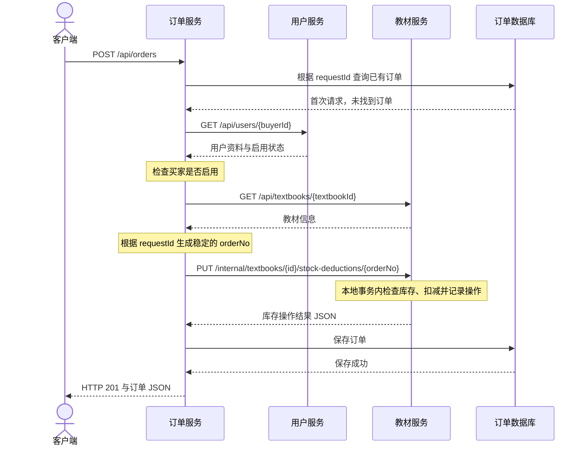

# 第八周：服务间同步调用

本周在校园二手教材微服务项目中实现服务间同步调用。
选择创建教材订单作为跨服务业务流程，使用 OpenFeign 调用用户服务，
通过两个用户服务实例的请求日志验证负载均衡，
并使用自动化测试和端到端脚本验证正常流程、依赖故障和恢复行为。

## 一、项目环境

项目使用 Spring Boot、Spring Data JPA、MySQL、
Spring Cloud Alibaba Nacos、OpenFeign 和 Docker Compose。

| 项目 | 配置 |
|---|---|
| Java | 25 |
| Spring Boot | 4.0.8 |
| Spring Cloud | 2025.1.0 |
| Spring Cloud Alibaba | 2025.1.0.0 |
| OpenFeign Core | 5.0.0 |
| 服务注册与发现 | Nacos |
| 数据库 | MySQL |
| 服务编排 | 根目录 compose.yaml |

### 1.1 服务职责

| 服务 | 工程目录 | 业务职责 |
|---|---|---|
| 用户服务 | `services/user-service/` | 管理用户资料，提供用户查询接口 |
| 教材服务 | `services/textbook-service/` | 管理教材、上架状态和库存 |
| 订单服务 | `services/order-service/` | 协调下单流程，保存和查询订单 |

三个服务分别维护自己的数据库。
用户服务的两个实例共享用户服务数据库，
不为同一个服务的每个实例建立独立数据库。

### 1.2 运行位置与访问方式

PowerShell 命令以仓库根目录为起点：

```powershell
Set-Location D:\microservices\microservices-practice-2412190107
```

Git Bash 中对应的目录为：

```bash
cd /d/microservices/microservices-practice-2412190107
```

| 用途 | 地址或方式 |
|---|---|
| Nacos 控制台 | `http://localhost:18081/` |
| 教材服务 | `http://localhost:8082` |
| 订单服务 | `http://localhost:8083` |
| 用户服务实例 | 从宿主机端口范围 `18091-18099` 分配 |
| 容器间用户查询 | 通过服务名 `user-service` 发现实例 |

运行前需准备根目录 `.env`，
填写数据库和 Nacos 所需配置，并完成 Nacos 初始化。

当前用户服务不再固定绑定宿主机 8081。
实际端口通过以下命令查询：

```powershell
docker compose port --index 1 user-service 8080
docker compose port --index 2 user-service 8080
```

## 二、选择一个跨服务业务流程

### 2.1 设计思路

选择“创建教材订单”作为跨服务业务流程。
订单服务接收下单请求，查询用户资料并检查买家是否启用，
再查询教材信息，随后请求教材服务检查上架状态和库存并扣减库存，
最后保存订单。

该流程涉及用户、教材和订单三个业务职责，必须由多个服务协作完成。
订单服务负责协调，用户服务提供用户资料，
教材服务负责库存规则与库存操作。
服务之间通过 HTTP 接口协作，不直接访问其他服务的数据库。

### 2.2 调用方、被调用方和接口

| 调用方 | 被调用方 | HTTP 方法及接口路径 | 用途 |
|---|---|---|---|
| 客户端 | 订单服务 | `POST /api/orders` | 创建订单 |
| 订单服务 | 用户服务 | `GET /api/users/{id}` | 查询买家资料 |
| 订单服务 | 教材服务 | `GET /api/textbooks/{id}` | 查询教材信息 |
| 订单服务 | 教材服务 | `PUT /internal/textbooks/{id}/stock-deductions/{orderNo}` | 幂等扣减库存 |
| 客户端 | 订单服务 | `GET /api/orders/{id}` | 查询订单 |

下单请求包含以下字段：

```json
{
  "requestId": "UUID格式的请求编号",
  "buyerId": 2,
  "textbookId": 4,
  "quantity": 1
}
```

其中用户和教材编号必须对应真实存在的数据。
正常创建订单返回 HTTP 201 和订单 JSON。

### 2.3 调用链路



详细设计见
[服务间同步通信设计](../../service-communication.md)。

### 2.4 源码核对命令

查看订单流程：

```powershell
Get-Content services/order-service/src/main/java/com/zjgsu/zy/service/OrderService.java -Encoding utf8
```

查看接口声明：

```powershell
Get-ChildItem .\services -Recurse -Filter '*Controller.java' |
    Select-String -Pattern '@RequestMapping|@GetMapping|@PostMapping|@PutMapping'
```

### 2.5 完成情况和关键结论

已明确创建订单的调用方向、接口路径、业务职责和数据库边界。
订单服务先执行远程校验和库存操作，再保存本地订单。

订单服务通过 requestId 识别重复订单，
教材服务通过稳定的 orderNo 和库存操作记录识别重复扣减。
相同请求编号必须对应相同的业务参数。

库存扣减和订单保存属于不同服务的本地事务。
幂等机制可以减少重复操作，但不能保证跨服务原子性。
远程写操作超时后，必须保留原请求编号重试。

## 三、使用 OpenFeign

### 3.1 实现思路

将订单服务查询用户的同步调用改为 OpenFeign。

调用方位于 `services/order-service/`，
被调用方位于 `services/user-service/`。

订单服务增加以下依赖：

```xml
<dependency>
    <groupId>org.springframework.cloud</groupId>
    <artifactId>spring-cloud-starter-openfeign</artifactId>
</dependency>

<dependency>
    <groupId>org.springframework.cloud</groupId>
    <artifactId>spring-cloud-starter-loadbalancer</artifactId>
</dependency>
```

启动类使用：

```java
@EnableFeignClients(clients = UserFeignClient.class)
```

客户端通过服务名声明：

```java
@FeignClient(name = "user-service")
public interface UserFeignClient {

    @GetMapping("/api/users/{id}")
    UserClient.UserInfo get(@PathVariable("id") Long id);
}
```

正式环境不配置该客户端的固定 URL，
通过 Nacos 服务发现获取用户服务实例，不写死容器 IP。

现有 OrderService.create() 调用 UserClient.requireEnabled()，
由 UserClient 发起 Feign 请求并检查用户状态。

订单服务查询教材和扣减库存继续使用原有客户端。
本小题完成的是订单服务到用户服务的 OpenFeign 调用。

### 3.2 主要代码位置

| 文件 | 内容 |
|---|---|
| `services/order-service/pom.xml` | Spring Cloud BOM、OpenFeign 和 LoadBalancer 依赖 |
| `services/order-service/src/main/java/com/zjgsu/zy/OrderApplication.java` | 启用 Feign |
| `services/order-service/src/main/java/com/zjgsu/zy/client/UserFeignClient.java` | 按服务名调用用户查询接口 |
| `services/order-service/src/main/java/com/zjgsu/zy/client/UserClient.java` | 用户检查和 Feign 异常转换 |
| `services/order-service/src/main/java/com/zjgsu/zy/controller/ApiExceptionHandler.java` | 返回统一错误 JSON |
| `services/order-service/src/main/resources/application.yml` | 超时和日志配置 |

### 3.3 超时及失败处理

连接超时为 2000ms，读取超时为 3000ms。
客户端启用 BASIC 请求日志及 DEBUG 日志。

调用异常转换为 ApiException，
再由统一异常处理器返回 HTTP 状态及包含 code、message 的 JSON。

| 场景 | HTTP 状态 | 错误码 |
|---|---:|---|
| 用户不存在 | 422 | DEPENDENCY_NOT_FOUND |
| 用户未启用 | 422 | USER_DISABLED |
| 用户服务拒绝业务请求 | 409 | DEPENDENCY_REJECTED |
| 无可用实例、连接失败、超时或下游服务端错误 | 503 | DEPENDENCY_UNAVAILABLE |
| 响应异常或数据不完整 | 502 | INVALID_DEPENDENCY_RESPONSE |

实际验证的失败响应：

```json
{
  "code": "DEPENDENCY_UNAVAILABLE",
  "message": "用户服务暂时不可用，请稍后使用原requestId重试"
}
```

### 3.4 构建与部署命令

```powershell
mvn -f services/order-service/pom.xml clean verify

docker compose --progress plain build order-service

docker compose up -d --no-deps --force-recreate order-service

docker compose ps order-service
```

必须在镜像构建成功结束后重新创建容器。
仅重新创建容器不会编译本地源码。

核对容器内的客户端和依赖：

```powershell
New-Item -ItemType Directory -Force .\work | Out-Null

$orderContainer = docker compose ps -q order-service

docker cp "${orderContainer}:/app/app.jar" .\work\running-order.jar

jar tf .\work\running-order.jar |
    Select-String -Pattern "UserFeignClient|spring-cloud-openfeign"
```

实际输出包含：

```text
BOOT-INF/classes/com/zjgsu/zy/client/UserFeignClient.class
BOOT-INF/lib/spring-cloud-openfeign-core-5.0.0.jar
```

### 3.5 正常调用验证

本次手动验证使用买家 2、教材 4。
复现时应先确认用户启用、教材已上架且库存充足，
必要时创建新的测试教材。

准备请求文件：

```powershell
New-Item -ItemType Directory -Force .\work | Out-Null

@{
    requestId = [guid]::NewGuid().ToString()
    buyerId = 2
    textbookId = 4
    quantity = 1
} | ConvertTo-Json |
    Set-Content .\work\w08-order.json -Encoding ascii
```

发送请求：

```powershell
curl.exe -i -X POST "http://localhost:8083/api/orders" `
    -H "Content-Type: application/json" `
    --data-binary "@work/w08-order.json"
```

查看 Feign 日志：

```powershell
docker compose logs --since=5m order-service |
    Select-String -Pattern "UserFeignClient" -Context 1,2
```

实际日志：

```text
[UserFeignClient#get] ---> GET http://user-service/api/users/2 HTTP/1.1
[UserFeignClient#get] <--- HTTP/1.1 200 (159ms)
```

该日志确认订单服务实际通过 OpenFeign 查询用户，
请求目标使用 user-service 服务名。

### 3.6 服务不可用与恢复验证

停止用户服务：

```powershell
docker compose stop user-service
```

为独立的失败场景生成新的请求编号，
避免已有成功订单的幂等返回绕过远程调用：

```powershell
$orderRequest = Get-Content .\work\w08-order.json -Raw | ConvertFrom-Json
$orderRequest.requestId = [guid]::NewGuid().ToString()

$orderRequest | ConvertTo-Json |
    Set-Content .\work\w08-order.json -Encoding ascii
```

重新发送下单请求，实际返回 HTTP 503 和清晰错误 JSON。

恢复用户服务：

```powershell
docker compose start user-service
docker compose ps user-service
```

等待服务健康并重新注册后，
保留失败请求原来的请求文件及 requestId 再次发送：

```powershell
curl.exe -i -X POST "http://localhost:8083/api/orders" `
    -H "Content-Type: application/json" `
    --data-binary "@work/w08-order.json"
```

当前为双实例配置。
停止 user-service 时会停止该服务的全部实例，
start 命令恢复已有容器。

### 3.7 实际结果

| 验证项目 | 实际结果 |
|---|---|
| 容器内客户端 | 包含 UserFeignClient.class |
| 容器内依赖 | OpenFeign Core 5.0.0 |
| 正常用户查询 | HTTP 200，159ms |
| 用户服务停止后下单 | HTTP 503，DEPENDENCY_UNAVAILABLE |
| 错误提示 | 用户服务暂时不可用，请稍后使用原requestId重试 |
| 恢复后原请求重试 | HTTP 201 |
| 恢复后创建订单 | ID 11，PENDING_PAYMENT |

关键结论：
OpenFeign 同步调用和业务校验已接入下单流程，
依赖不可用时不会返回业务成功，
服务恢复后可以保留原请求编号继续下单。

## 四、负载均衡验证

### 4.1 实现思路

将被调用方 user-service 启动为两个实例，
使用相同服务名注册到 Nacos 的 CAMPUS_TEXTBOOK_GROUP。

订单服务继续通过 OpenFeign 按服务名调用，
通过现有 Spring Cloud LoadBalancer 选择目标实例。

验证时，客户端向订单服务传入唯一的 X-LB-Test-Id，
订单服务通过 Feign RequestInterceptor 转发请求标记，
用户服务成功查询用户后记录实例主机名和请求标记。

所有验证请求均发送到订单服务的 POST /api/orders，
通过下游日志核验实际分发。

### 4.2 Compose 配置

user-service 的关键配置：

```yaml
  user-service:
    <<: *app-common
    scale: 2
    image: campus-user-service:week06

    # 保留原有 build、depends_on 和 environment 配置

    ports:
      - target: 8080
        published: "18091-18099"
        host_ip: 127.0.0.1
        protocol: tcp
```

两个实例监听各自容器内部的 8080，
但使用不同的宿主机端口。

本次启动映射：

| 实例 | 宿主机地址 | 容器端口 |
|---|---|---:|
| user-service-1 | 127.0.0.1:18091 | 8080 |
| user-service-2 | 127.0.0.1:18092 | 8080 |

实际端口和容器主机名可能在重建后变化，
复现时以当前查询结果为准。

### 4.3 请求关联代码

订单服务的 HttpClientConfig 增加 RequestInterceptor，
从当前 HTTP 请求中读取 X-LB-Test-Id 并转发到 Feign 请求。

用户服务的 UserController 接收可选请求头，
成功查询用户后记录：

```text
USER_QUERY instance=<容器主机名> userId=<用户编号> lbTestId=<请求标记>
```

对应文件：

- `services/order-service/src/main/java/com/zjgsu/zy/config/HttpClientConfig.java`
- `services/user-service/src/main/java/com/zjgsu/zy/controller/UserController.java`

### 4.4 构建和启动命令

```powershell
docker compose config --quiet

docker compose --progress plain build user-service order-service

docker compose up -d --no-deps --force-recreate --scale user-service=2 user-service

docker compose ps -a user-service
```

启动初期可能显示 health: starting。
等待两个实例健康，并确认 Nacos 中两个实例健康后再验证。

查询端口和主机名：

```powershell
docker compose port --index 1 user-service 8080
docker compose port --index 2 user-service 8080

docker compose ps -q user-service | ForEach-Object {
    docker inspect --format '{{.Name}} hostname={{.Config.Hostname}}' $_
}
```

重新创建订单服务：

```powershell
docker compose up -d --no-deps --force-recreate order-service
docker compose ps order-service
```

### 4.5 准备测试教材

使用已有启用卖家 1、买家 2。
创建库存为 20 的独立教材：

```powershell
$bookBody = @{
    title = "LoadBalancer Test Book"
    isbn = "lb-" + [guid]::NewGuid().ToString("N").Substring(0, 20)
    author = "Test Author"
    publisher = "Test Publisher"
    conditionDescription = "Almost new"
    price = 25.50
    stock = 20
    sellerId = 1
} | ConvertTo-Json

$lbBook = Invoke-RestMethod `
    -Method Post `
    -Uri "http://localhost:8082/api/textbooks" `
    -ContentType "application/json" `
    -Body $bookBody

$lbBook
```

### 4.6 连续发送六次下单请求

在同一个 PowerShell 窗口执行：

```powershell
$runId = "lb-" + [guid]::NewGuid().ToString("N")
Write-Host "本批验证标记：$runId"

$results = 1..6 | ForEach-Object {
    $testId = "$runId-$_"

    $body = @{
        requestId = [guid]::NewGuid().ToString()
        buyerId = 2
        textbookId = $lbBook.id
        quantity = 1
    } | ConvertTo-Json

    $response = Invoke-WebRequest `
        -UseBasicParsing `
        -Method Post `
        -Uri "http://localhost:8083/api/orders" `
        -ContentType "application/json" `
        -Headers @{ "X-LB-Test-Id" = $testId } `
        -Body $body

    $order = $response.Content | ConvertFrom-Json

    [pscustomobject]@{
        TestId = $testId
        HttpStatus = [int]$response.StatusCode
        OrderId = $order.id
        Status = $order.status
    }
}

$results | Format-Table -AutoSize
```

每次 requestId 不同，确保实际执行远程查询。

### 4.7 查询日志与命中统计

立即在同一窗口执行：

```powershell
New-Item -ItemType Directory -Force .\work | Out-Null

$lbLogs = docker compose logs --no-color --since=10m user-service |
    Select-String -SimpleMatch $runId |
    ForEach-Object { $_.Line }

$lbLogs | Tee-Object -FilePath .\work\w08-lb-user.log

$hits = $lbLogs | ForEach-Object {
    if ($_ -match 'instance=(\S+)') {
        $Matches[1]
    }
} | Group-Object

$hits | Select-Object @{Name="Instance"; Expression={$_.Name}}, Count
```

只统计本批次请求，排除启动日志和历史调用。

### 4.8 实际结果

验证日期：2026 年 11 月 16 日。

本批次标记：

```text
lb-9f4e0c9326604db4ac1dc967f982d915
```

六次下单结果：

| 请求序号 | HTTP 状态 | 订单 ID | 状态 |
|---|---:|---:|---|
| 1 | 201 | 12 | PENDING_PAYMENT |
| 2 | 201 | 13 | PENDING_PAYMENT |
| 3 | 201 | 14 | PENDING_PAYMENT |
| 4 | 201 | 15 | PENDING_PAYMENT |
| 5 | 201 | 16 | PENDING_PAYMENT |
| 6 | 201 | 17 | PENDING_PAYMENT |

实例命中结果：

| 实例 | 主机名 | 请求序号 | 命中次数 |
|---|---|---|---:|
| user-service-1 | 2cc0e594b082 | 2、4、6 | 3 |
| user-service-2 | e7a2c78ac107 | 1、3、5 | 3 |

两个实例的日志均包含与客户端对应的 lbTestId，
证明订单服务实际访问到了两个用户服务实例。

本次请求表现为交替命中，每个实例三次。
该结果证明本批次分发成功，
不代表任意请求规模下都保证严格等量分配。

### 4.9 关键结论

两个用户服务实例使用不同的宿主机端口运行，
订单服务通过同一个服务名发起请求。
唯一请求标记、容器日志前缀和主机名构成可核验的分发证据，
满足实际访问两个实例的验证要求。

## 五、测试

### 5.1 测试设计

测试分为应用内 HTTP 集成测试和真实环境端到端验证。

应用内测试使用真实 Feign 客户端、本机随机端口 HTTP 桩、
教材 HTTP 客户端及 H2 订单数据库，
验证 service 层的完整调用与异常处理。

端到端脚本通过真实用户服务、教材服务、订单服务、
Nacos 和 MySQL 验证业务流程。
脚本从仓库根目录执行，自动创建独立测试数据，
不依赖历史测试用户或教材编号。

### 5.2 测试文件

| 文件 | 作用 |
|---|---|
| `services/order-service/src/test/java/com/zjgsu/zy/RealHttpClientTest.java` | 真实 HTTP 调用、依赖失败、超时和幂等恢复 |
| `services/order-service/src/test/java/com/zjgsu/zy/OrderApiTest.java` | 订单接口状态、错误 JSON、订单查询及幂等等 |
| `services/order-service/src/test/java/com/zjgsu/zy/TextbookDiscoveryTest.java` | 教材服务无实例或发现失败的异常处理 |
| `services/order-service/src/test/resources/application-test.yml` | H2 和测试专用客户端配置 |
| `scripts/e2e-test.sh` | 真实环境跨服务端到端验证 |

测试配置中的用户服务固定 URL 仅用于本机 HTTP 桩。
正式环境继续通过 Nacos 按 user-service 服务名调用。

### 5.3 Feign/service 测试内容

RealHttpClientTest 包含五项测试：

| 测试方法 | 验证内容 |
|---|---|
| feignAndRestTemplateMakeThreeRealHttpCalls | 正常下单经过三次真实 HTTP 调用，保存一笔订单并扣减库存 |
| realHttp404DoesNotWriteOrder | 用户不存在时返回 422，不保存订单，不扣库存 |
| realHttp503DoesNotWriteOrder | 用户服务返回 503 时，不保存订单，不扣库存 |
| realReadTimeoutDoesNotWriteOrder | 用户查询读取超时返回 503，不保存订单 |
| writeTimeoutMayHaveCommittedAndSameRequestCanRecover | 库存端已执行但响应超时，保留原请求编号重试后恢复且不重复扣减 |

上述 HTTP 桩使用真实 socket，
Feign 客户端没有被 Mockito 替换。

### 5.4 写操作超时后的结果可能未知

写操作读取超时，只能说明调用方没有及时收到响应，
不能据此判断远端操作未执行。
远端可能已经修改库存并提交，
但响应在返回途中延迟或丢失。

测试通过 HTTP 桩模拟以下过程：

1. 初始模拟远端库存为 3。
2. 库存请求到达后先扣减一次，库存变为 2。
3. 远端延迟响应，使订单服务读取超时。
4. 订单服务返回依赖不可用异常，本地订单数量为 0。
5. 保留原 requestId 重试，使用相同 orderNo。
6. 库存端返回原操作结果，不再次扣减。
7. 本地保存一笔订单，库存仍为 2。
8. 再次重复请求，返回相同订单，库存及订单数量保持不变。

实际测试输出：

```text
[CHECK] WRITE_TIMEOUT: remoteStock=2, localOrders=0
[PASS] SAME_REQUEST_RECOVERY: remoteStock=2, localOrders=1
```

因此写操作超时后必须保留原 requestId 和业务参数，
不能通过更换编号将不确定请求当作新的业务请求提交。

该测试验证幂等恢复行为，
不代表项目具有跨服务原子事务保证。
模拟远端库存状态由 HTTP 桩维护，
实际订单写入使用 H2 数据库。

### 5.5 端到端脚本设计

scripts/e2e-test.sh 执行以下流程：

1. 校验 Docker Compose 配置和所需命令。
2. 检查两个用户服务实例及业务服务健康状态。
3. 自动查询用户实例实际宿主机端口。
4. 创建独立卖家、买家和初始库存为 5 的教材。
5. 创建购买数量为 2 的订单。
6. 检查订单响应、数据库订单数量及库存变为 3。
7. 查询订单并核对结果。
8. 重复原请求，确认返回相同订单且库存仍为 3。
9. 为故障场景生成新的 requestId，停止全部用户服务实例。
10. 确认下单返回 503 和 DEPENDENCY_UNAVAILABLE。
11. 查询订单数据库，确认失败请求对应订单数量为 0。
12. 查询教材，确认库存仍为 3。
13. 恢复原用户服务容器并等待健康。
14. 使用故障场景原请求编号重试，确认创建成功。
15. 确认对应订单只有一笔，库存变为 2。
16. 再次重复恢复请求，确认订单和库存不再变化。

数据库检查使用本次唯一 requestId，
查询 trade_orders 中对应记录的数量，
不把历史订单计入结果。

脚本异常退出或中断时会尝试恢复被停止的用户服务。
脚本保留请求和响应文件，便于核对失败原因。

端到端脚本验证真实依赖不可用及恢复；
“远端写入已执行但响应超时”通过 HTTP 桩测试验证。

### 5.6 运行命令

在仓库根目录的 PowerShell 中运行针对性测试：

```powershell
mvn -f services/order-service/pom.xml "-Dtest=RealHttpClientTest" test
```

需要运行项目已有完整测试时，可执行：

```powershell
mvn -f services/user-service/pom.xml test
mvn -f services/textbook-service/pom.xml test
mvn -f services/order-service/pom.xml clean verify
```

运行端到端脚本前，确认真实环境中的服务已部署：

```powershell
docker compose ps
```

在 Git Bash 中，从仓库根目录执行：

```bash
bash -n scripts/e2e-test.sh

set -o pipefail
mkdir -p work
bash scripts/e2e-test.sh 2>&1 | tee work/w08-e2e-console.log
```

脚本需要 Bash、Docker Compose、curl 和 Python 3，
自动识别 python3 或 python，不依赖 jq。

### 5.7 Feign/service 测试实际结果

验证日期：2026 年 11 月 16 日。

RealHttpClientTest 实际结果：

```text
Tests run: 5
Failures: 0
Errors: 0
Skipped: 0
BUILD SUCCESS
```

测试日志中的 HTTP 404、HTTP 503 和 SocketTimeoutException
来自主动模拟的异常场景。
这些场景的断言通过，最终测试结果没有失败或错误。

写超时场景实际确认：

| 阶段 | 模拟远端库存 | 本地订单数量 |
|---|---:|---:|
| 初始状态 | 3 | 0 |
| 库存执行成功但调用方超时 | 2 | 0 |
| 原请求重试恢复后 | 2 | 1 |
| 再次重复请求后 | 2 | 1 |

本次记录的五项通过结果属于 RealHttpClientTest，
不将其数量表述为三个服务的全部测试数量。

### 5.8 端到端实际结果

本次脚本运行编号：

```text
182f0dfdd10a4664
```

证据目录：

```text
work/w08-e2e-182f0dfdd10a4664
```

控制台日志：

```text
work/w08-e2e-console.log
```

实际检查结果：

| 场景 | HTTP 状态 | 对应请求订单数量 | 库存 | 其他结果 |
|---|---:|---:|---:|---|
| 正常下单，购买两本 | 201 | 1 | 3 | 订单 ID 18 |
| 查询订单 | 200 | — | — | 查询成功 |
| 重复正常下单请求 | 201 | 1 | 3 | 返回相同订单 |
| 停止全部用户实例后下单 | 503 | 0 | 3 | DEPENDENCY_UNAVAILABLE |
| 恢复后使用原故障请求重试 | 201 | 1 | 2 | 订单 ID 19 |
| 再次重复恢复请求 | 201 | 1 | 2 | 返回相同订单 |

实际控制台输出：

```text
[PASS] NORMAL_ORDER: HTTP=201, orderId=18, stock=3, dbCount=1
[PASS] ORDER_QUERY: HTTP=200
[PASS] IDEMPOTENT_RETRY: same orderId, stock=3, dbCount=1
[PASS] DEPENDENCY_DOWN: HTTP=503, dbCount=0, stock=3
[PASS] RECOVERY: HTTP=201, orderId=19, stock=2, dbCount=1
[PASS] RECOVERY_RETRY: same orderId, stock=2, dbCount=1
[PASS] ALL E2E CHECKS PASSED
```

### 5.9 完成情况与关键结论

Feign/service 层五项真实 HTTP 测试已通过，
端到端脚本的全部检查已通过。

测试验证了正常下单、订单查询、库存变化、幂等请求、
依赖不可用和恢复重试。
用户服务不可用时，订单接口返回 503，
失败请求没有对应订单，库存也没有变化，
说明调用失败没有被当作业务成功。

写操作读取超时可能发生在远端已经执行之后。
HTTP 桩测试确认该情况下本地没有订单而远端库存已经变化，
保留原请求编号重试后可以恢复，
并避免重复订单和重复扣减。

## 六、本周完成情况

| 任务 | 完成结果 |
|---|---|
| 选择跨服务业务流程 | 明确创建教材订单的服务职责、接口及调用链路 |
| 使用 OpenFeign | 订单服务按 user-service 服务名查询用户，正常及失败处理验证通过 |
| 负载均衡验证 | 六次订单请求实际命中两个用户服务实例，各三次 |
| 测试 | 五项 Feign/service 测试及端到端脚本全部检查通过 |

本周验证基于实际请求、服务日志、订单数据库查询和库存查询。
实例主机名、自动分配端口、订单编号和测试数据编号
可能在重新运行后变化，应以对应批次的实际结果为准。
