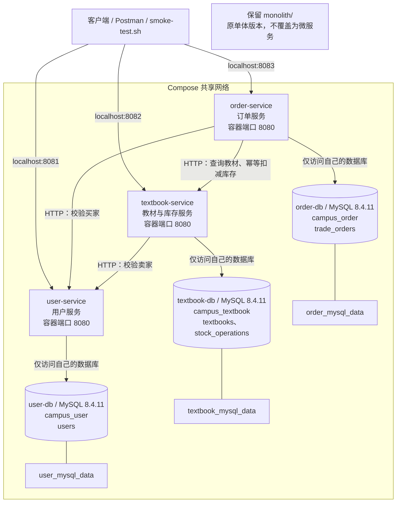

# 校园二手教材交易平台微服务拆分设计

## 一、设计目标与范围

基于已有 Spring Boot 单体应用，按照业务职责拆分为三个微服务：

1. 用户服务：user-service；
2. 教材服务：textbook-service；
3. 订单服务：order-service。

拆分后，各服务拥有独立工程、独立数据访问层和独立数据库，通过 HTTP API 协作。

保留的核心业务流程为：

```text
创建用户
→ 卖家发布教材
→ 买家查询教材
→ 买家提交订单
→ 校验用户、教材和库存
→ 扣减库存
→ 生成待支付订单
→ 查询订单
```

本周不实现真实支付、物流、评价、API 网关、服务注册中心和消息队列。

## 二、原单体工程保留原则

保留仓库中的 `monolith/`，作为上一阶段的单体版本。

仓库根目录：

```text
仓库根目录/
├── monolith/                     # 保留原单体工程
├── services/
│   ├── user-service/
│   │   ├── pom.xml
│   │   ├── Dockerfile
│   │   └── src/
│   ├── textbook-service/
│   │   ├── pom.xml
│   │   ├── Dockerfile
│   │   └── src/
│   └── order-service/
│       ├── pom.xml
│       ├── Dockerfile
│       └── src/
├── compose.yaml                  # 根目录统一编排
├── .env.example
├── scripts/
│   └── smoke-test.sh
├── docs/
│   └── microservices-design.md
└── README.md
```

三个服务的基础包名均继续使用：

```java
com.zjgsu.zy
```

每个服务内部按照职责组织子包：

```text
com.zjgsu.zy
├── controller
├── dto
├── model
├── repository
├── service
└── client
```

其中 `client` 用于封装对其他服务的 HTTP 调用，不用于引用其他服务的 Repository。

## 三、单体模块到微服务的拆分映射

| 原单体模块或能力 | 拆分后归属 | 调整说明 |
|---|---|---|
| 原有 buyerId、sellerId 用户标识 | user-service | 新增用户模型和用户查询能力，提供用户存在性及状态校验 |
| Textbook 模型 | textbook-service | 拥有教材信息、价格、库存和上架状态 |
| TextbookRepository | textbook-service | 仅访问教材服务自己的数据库 |
| TextbookController | textbook-service | 提供教材创建、列表查询和详情查询 |
| TradeService 中教材创建和查询逻辑 | textbook-service | 拆分为教材业务逻辑 |
| TradeService 中库存校验及扣减逻辑 | textbook-service | 库存规则与教材数据保持在同一个服务内 |
| TradeOrder、OrderStatus | order-service | 保存订单、交易快照和订单状态 |
| TradeOrderRepository | order-service | 仅访问订单服务自己的数据库 |
| OrderController | order-service | 提供订单创建和详情查询 |
| TradeService 中订单编排逻辑 | order-service | 通过 HTTP 调用用户服务及教材服务，不直接读取其数据表 |
| 单体健康检查能力 | 三个服务分别提供 | 各自提供 `/actuator/health` |

原单体中的 `TradeService` 同时负责教材和订单，不直接整体复制为一个微服务，而是按业务职责拆分。

## 四、服务职责、端口与数据归属

### 4.1 服务总览

| 服务 | 职责 | 本机访问端口 | 容器内端口 | 独立数据库 | 拥有的数据表 |
|---|---|---:|---:|---|---|
| user-service | 用户创建、用户查询、用户状态管理 | 8081 | 8080 | campus_user | users |
| textbook-service | 教材发布、检索、详情、上架状态、库存管理 | 8082 | 8080 | campus_textbook | textbooks、stock_operations |
| order-service | 订单创建、交易快照、订单查询、跨服务调用编排 | 8083 | 8080 | campus_order | trade_orders |

本机 8080 端口保留给原单体版本，微服务分别使用 8081、8082、8083，避免端口冲突。

不同容器拥有独立网络空间，三个服务的容器内端口都是 8080。

### 4.2 用户服务 user-service

职责：

- 创建校园用户；
- 根据用户 ID 查询用户信息；
- 提供用户是否存在、是否启用的查询结果；
- 为教材发布和订单创建提供用户基础信息。

拥有的数据表：

```text
campus_user.users
```

主要字段：

| 字段 | 说明 |
|---|---|
| id | 用户主键 |
| student_no | 学号，唯一 |
| display_name | 用户显示名称 |
| enabled | 是否启用 |
| created_at | 创建时间 |

设计说明：

- 同一个校园用户既可以购买教材，也可以发布教材，因此不为买家和卖家分别建表。
- 用户服务不读取教材表和订单表。
- 用户存在性校验不等同于登录认证或权限控制，认证授权属于后续扩展范围。

### 4.3 教材服务 textbook-service

职责：

- 创建教材；
- 按书名或 ISBN 查询教材；
- 查询教材详情；
- 管理价格、库存和上架状态；
- 在本地事务中检查教材是否上架、库存是否充足；
- 为订单服务提供带幂等标识的库存扣减接口。

拥有的数据表：

```text
campus_textbook.textbooks
campus_textbook.stock_operations
```

`textbooks` 主要字段：

| 字段 | 说明 |
|---|---|
| id | 教材主键 |
| seller_id | 卖家用户 ID，仅为跨服务标识 |
| title | 教材名称 |
| isbn | ISBN |
| author | 作者 |
| publisher | 出版社 |
| condition_description | 教材成色 |
| price | 教材价格 |
| stock | 可售库存 |
| listed | 是否上架 |
| created_at | 创建时间 |
| updated_at | 更新时间 |

保留单体版本中的主要约束：

- 售价必须大于 0；
- 库存不能为负数；
- 同一卖家的 ISBN 具有唯一约束；
- 未上架或库存不足时不能扣减库存。

`stock_operations` 用于记录库存扣减结果，主要字段：

| 字段 | 说明 |
|---|---|
| id | 主键 |
| order_no | 订单编号，唯一幂等标识，不建立跨库外键 |
| textbook_id | 本服务教材 ID |
| quantity | 扣减数量 |
| unit_price | 扣减成功时的成交单价快照 |
| textbook_title | 教材名称快照 |
| seller_id | 卖家 ID 快照 |
| created_at | 操作时间 |

设计说明：

- 同一订单编号重复请求时，返回第一次成功的扣减结果，不重复扣库存。
- 相同订单编号携带不同教材或数量时，拒绝请求。
- 库存扣减和扣减记录写入同一个本地事务。
- 并发控制在教材服务内部完成，不能仅依赖“先查询库存，再普通覆盖库存”的方式。
- `stock_operations` 是教材服务自己的业务数据，不是共享订单表。

### 4.4 订单服务 order-service

职责：

- 接收买家提交的订单请求；
- 通过用户服务校验买家；
- 通过教材服务获取教材信息并请求库存扣减；
- 保存订单和成交快照；
- 根据订单 ID 查询订单。

拥有的数据表：

```text
campus_order.trade_orders
```

主要字段：

| 字段 | 说明 |
|---|---|
| id | 订单主键 |
| order_no | 订单编号，唯一 |
| request_id | 客户端请求幂等标识，唯一 |
| buyer_id | 买家用户 ID |
| seller_id | 卖家用户 ID |
| textbook_id | 教材 ID |
| textbook_title | 下单时教材名称快照 |
| quantity | 购买数量 |
| unit_price | 成交单价快照 |
| total_amount | 订单总金额 |
| status | 订单状态 |
| created_at | 创建时间 |
| updated_at | 更新时间 |

订单服务不拥有教材库存，也不直接操作用户或教材表。

订单名称、卖家和价格等快照来自教材服务的可信响应，总金额由订单服务计算，不能直接相信客户端传入的价格。

## 五、独立数据访问原则

### 5.1 每个服务只访问自己的数据库

规划使用三个独立 MySQL 容器，每个服务拥有独立数据库、连接账号和命名数据卷：

| 应用服务 | MySQL 服务名 | 数据库 | 专用账号 | 命名数据卷 |
|---|---|---|---|---|
| user-service | user-db | campus_user | user_app | user_mysql_data |
| textbook-service | textbook-db | campus_textbook | textbook_app | textbook_mysql_data |
| order-service | order-db | campus_order | order_app | order_mysql_data |

三个 MySQL 容器均使用 MySQL 8.4.11。

连接地址分别为：

```text
user-service:
jdbc:mysql://user-db:3306/campus_user

textbook-service:
jdbc:mysql://textbook-db:3306/campus_textbook

order-service:
jdbc:mysql://order-db:3306/campus_order
```

数据库账号仅授权访问对应业务库。应用不使用 MySQL root 账号，不共享其他服务的数据库凭据。

数据库默认不需要映射到宿主机端口；后续如果需要使用 Workbench 查看数据，再按需配置不同的本机端口。

### 5.2 跨服务关联只保存 ID

例如：

```text
textbooks.seller_id → 用户服务中的用户 ID

trade_orders.buyer_id → 用户服务中的用户 ID
trade_orders.seller_id → 用户服务中的用户 ID
trade_orders.textbook_id → 教材服务中的教材 ID
```

这些关系是业务上的关联，不建立跨数据库外键，也不进行跨数据库 JOIN。

原单体中的：

```java
@ManyToOne
@JoinColumn(name = "textbook_id")
private Textbook textbook;
```

在新订单服务中应调整为普通 ID 字段：

```java
@Column(name = "textbook_id", nullable = false)
private Long textbookId;
```

原 `monolith/` 中的实体保持不变，只在新微服务工程中调整。

### 5.3 不跨服务访问 Repository

禁止以下方式：

- 订单服务注入教材服务的 `TextbookRepository`；
- 教材服务注入用户服务的 `UserRepository`；
- 一个服务连接另一个服务的数据库读取数据；
- 将其他服务工程作为依赖来复用其 Entity 或 Repository。

允许的方式：

```text
Controller
→ 本服务 Service
→ HTTP Client
→ 对方服务 API
```

服务之间通过请求、响应 DTO 交换数据，不直接返回或共享 JPA 实体。

## 六、服务间 HTTP 调用关系

### 6.1 本机与容器地址

| 服务 | 本机访问地址 | Compose 内部访问地址 |
|---|---|---|
| 用户服务 | http://localhost:8081 | http://user-service:8080 |
| 教材服务 | http://localhost:8082 | http://textbook-service:8080 |
| 订单服务 | http://localhost:8083 | http://order-service:8080 |

容器内调用使用 Compose 服务名，不能使用 `localhost:8081` 等本机地址。

### 6.2 调用方向

```text
textbook-service → user-service
```

用于发布教材时校验卖家是否存在及是否启用。

```text
order-service → user-service
```

用于下单时校验买家是否存在及是否启用。

```text
order-service → textbook-service
```

用于获取教材信息、请求库存扣减并取得成交快照。

用户服务不反向调用教材服务或订单服务，教材服务不反向调用订单服务，避免形成循环依赖。

### 6.3 规划接口

以下为后续实现的接口约定：

| 所属服务 | 方法 | 路径 | 作用 |
|---|---|---|---|
| user-service | POST | /api/users | 创建用户 |
| user-service | GET | /api/users/{id} | 查询用户和启用状态 |
| textbook-service | POST | /api/textbooks | 发布教材 |
| textbook-service | GET | /api/textbooks | 查询在售教材 |
| textbook-service | GET | /api/textbooks/{id} | 查询教材详情 |
| textbook-service | PUT | /internal/textbooks/{id}/stock-deductions/{orderNo} | 按订单编号幂等扣减库存 |
| order-service | POST | /api/orders | 创建订单 |
| order-service | GET | /api/orders/{id} | 查询订单 |

三个服务均提供：

```text
GET /actuator/health
```

健康接口应纳入数据库健康检查；依赖数据库不可用时，不应将该服务视为业务就绪。

库存扣减接口属于内部协作接口，`/internal` 路径本身不代表已经具有鉴权能力。课程环境仅用于本机实验，生产部署需要额外的访问控制。

## 七、核心业务流程与规则

### 7.1 发布教材

1. 客户端向教材服务提交教材和卖家 ID。
2. 教材服务通过 HTTP 查询用户服务。
3. 确认卖家存在且处于启用状态。
4. 校验教材字段、售价和库存。
5. 将教材保存到 `campus_textbook.textbooks`。

用户不存在或未启用时，拒绝发布，不写入教材数据。

### 7.2 创建订单

1. 客户端提交买家 ID、教材 ID、购买数量和 `requestId`。
2. 订单服务检查是否已有相同 `requestId` 的订单，防止重复创建。
3. 订单服务通过 HTTP 校验买家。
4. 订单服务通过 HTTP 查询教材，进行基本检查。
5. 订单服务生成唯一订单编号，在自己的数据库保存 `PROCESSING` 订单。
6. 订单服务请求教材服务按订单编号扣减库存。
7. 教材服务在本地事务中重新检查上架状态和库存，完成扣减并保存库存操作记录。
8. 教材服务返回实际成交价格、教材名称和卖家 ID。
9. 订单服务根据返回结果保存快照、计算金额，将订单更新为 `PENDING_PAYMENT`。
10. 客户端通过订单服务查询订单结果。

第 4 步的查询结果不能替代第 7 步的原子库存检查，因为查询后库存可能被其他订单改变。

`PROCESSING` 阶段尚未取得的成交快照字段允许为空；只有完成库存扣减和快照保存后，才进入 `PENDING_PAYMENT`。

### 7.3 HTTP 失败和事务边界

拆分后，原单体中的一个 `@Transactional` 不能同时回滚三个服务的数据。

因此采用以下设计：

- 各服务的事务只作用于自己的数据库；
- 用户校验失败时拒绝下单；
- 教材不存在、未上架或明确库存不足时，将处理中的订单标记为失败；
- 库存接口超时或连接中断时，结果可能未知，不能直接认定“没有扣库存”；
- 结果未知时订单保持 `PROCESSING`，使用原订单编号重试库存接口；
- 教材服务通过 `order_no` 唯一约束和本地事务保证重复请求不重复扣库存；
- 库存已扣减但订单状态更新失败时，后续使用原 `requestId` 和订单编号继续处理；
- 不能对库存扣减请求使用新的订单编号盲目重试。

本周不声称实现了跨服务强一致事务或完整 Saga。持久化处理中状态和幂等操作记录，是为基础 HTTP 协作提供可恢复的设计边界。

自动恢复任务、取消订单释放库存、支付超时补偿属于后续扩展；后续实现和验证必须说明实际支持的恢复方式。

## 八、拆分理由

### 8.1 用户服务独立

用户基础信息会被教材发布、订单创建等业务共同使用，具有独立生命周期。

集中管理用户，避免教材和订单服务分别维护一套用户主数据。

### 8.2 教材与库存保持在同一个服务

教材是否上架、价格和库存直接决定能否购买，业务关联紧密。

本周不将库存继续拆成第四个服务，以减少调用链和一致性处理复杂度，并保证库存规则能在一个数据库事务中执行。

### 8.3 订单服务独立

订单负责购买行为、交易快照和状态管理，与教材维护职责不同。

订单服务通过 API 获取外部信息，但自己拥有订单数据，可独立测试和演进。

### 8.4 不按技术层拆服务

不将 Controller、Service、Repository 各自拆成服务。

每个微服务都包含完成自身业务所需的 HTTP 接口、业务逻辑和数据访问层，实现业务职责内聚。

## 九、Mermaid 架构图



图中没有跨服务数据库连接，所有跨服务信息交换通过 HTTP 完成。

## 十、后续实现与验收约定

本步骤仅完成拆分设计，后续依次实现：

1. 创建三个具有独立 `pom.xml` 和 `src/` 的 Spring Boot 工程；
2. 配置各自的数据源、Entity、Repository 和健康接口；
3. 实现用户、教材和订单 API；
4. 封装基础 HTTP Client，设置连接和响应超时；
5. 配置根目录 Compose，使三个应用和三个数据库一键启动；
6. 为每个服务增加测试，并在 README 中说明执行方法；
7. 在根目录新增 `scripts/smoke-test.sh`；
8. 从仓库根目录执行：

```bash
bash scripts/smoke-test.sh
```

验证脚本应检查三个服务健康接口，并验证创建用户、发布教材、创建订单和查询订单的协作流程。

测试规划：

- 用户服务：用户保存、查询及重复学号校验；
- 教材服务：教材读写、库存不足、重复扣减幂等及用户服务调用；
- 订单服务：订单读写、用户和教材 HTTP 协作、下游失败响应；
- 测试不依赖实际运行中的其他服务，应使用 HTTP 桩或 Mock 模拟下游响应。

各服务的测试命令后续在 README 中分别说明，例如：

```bash
cd services/user-service
mvn test
```

其他服务在各自工程目录执行相同命令。

## 十一、设计结论

本项目按用户、教材与库存、订单三个业务边界拆分服务。各服务拥有独立工程、独立数据库和专用数据库账号，通过 HTTP API 协作。跨服务关联仅保存 ID，不建立跨库外键，不直接调用其他服务的 Repository。

本次设计保留原单体版本，并明确库存本地事务、远程调用失败和幂等重试的边界，为后续微服务实现与容器编排提供依据。