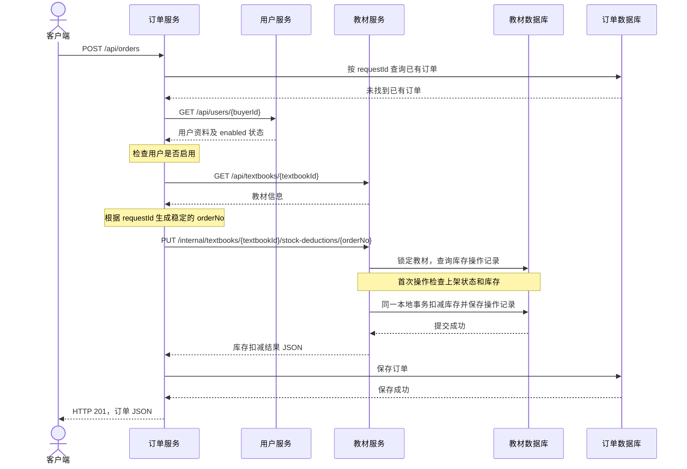

# 服务间同步通信设计

本项目选择“创建教材订单”作为跨服务业务流程。订单服务接收下单请求，
调用用户服务查询买家并检查启用状态，再调用教材服务查询教材信息，
随后请求教材服务检查上架状态和库存并扣减库存。库存操作成功后，
订单服务保存订单。该流程由三个服务协作完成，能够体现同步调用、
业务职责划分以及独立数据库之间的协作方式。

## 服务职责与工程位置

| 服务 | 工程位置 | 职责 |
|---|---|---|
| 订单服务 | `services/order-service/` | 协调下单流程、处理请求编号、保存和查询订单 |
| 用户服务 | `services/user-service/` | 管理用户资料，提供用户查询接口 |
| 教材服务 | `services/textbook-service/` | 管理教材与库存，执行库存检查和扣减 |

各服务只访问自己的数据库，不直接查询或修改其他服务的数据库。

## 调用接口

| 调用方 | 被调用方 | HTTP 方法及接口路径 | 用途 |
|---|---|---|---|
| 客户端 | 订单服务 | `POST /api/orders` | 创建订单 |
| 订单服务 | 用户服务 | `GET /api/users/{id}` | 查询买家资料，由订单服务检查启用状态 |
| 订单服务 | 教材服务 | `GET /api/textbooks/{id}` | 查询教材信息 |
| 订单服务 | 教材服务 | `PUT /internal/textbooks/{id}/stock-deductions/{orderNo}` | 检查上架状态和库存，幂等扣减库存 |
| 客户端 | 订单服务 | `GET /api/orders/{id}` | 查询订单结果 |

创建订单的请求字段为 `requestId`、`buyerId`、`textbookId` 和 `quantity`。
其中 `requestId` 为 UUID，库存扣减请求体包含 `buyerId` 和 `quantity`。
正常创建订单返回 HTTP 201 和订单 JSON；库存扣减接口返回扣减结果 JSON。

## 调用链路

下面展示首次成功下单的主要链路。

## 幂等与失败处理

1. 订单服务先按 `requestId` 查询订单。已有订单且买家、教材和数量一致时，
   直接返回已有订单；请求参数不同则返回冲突。
2. 订单编号由 `requestId` 稳定生成，重试时保持相同的库存操作标识。
3. 教材服务通过库存操作记录识别重复扣减，相同操作返回原扣减结果；
   同一编号携带不同参数则拒绝。
4. 用户未启用、教材不存在、教材未上架或库存不足时，流程终止，
   不继续创建本地订单。
5. 教材服务无可用实例，或者远程连接失败、超时时，订单服务返回 503。
   库存调用超时后，实际扣减结果可能未知，重试必须使用原 `requestId`。
6. 库存扣减和订单保存分属不同服务的本地事务，不具备跨服务原子性。
   库存成功而订单保存失败时，需要保留原请求编号重试，不能直接更换编号。

## 完成情况与关键结论

已根据现有代码确认创建订单涉及订单服务、用户服务和教材服务，
明确了调用方向、接口路径、数据库边界及主要失败处理方式。
当前同步调用使用 RestTemplate，订单服务调用教材服务时通过
DiscoveryClient 获取 Nacos 中的实例；用户服务调用使用配置的基础地址。

订单服务负责流程协调，用户服务提供用户资料，
教材服务负责库存规则及扣减，幂等机制减少重复操作但不等同于分布式事务。
